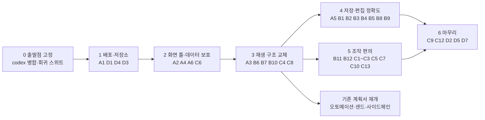
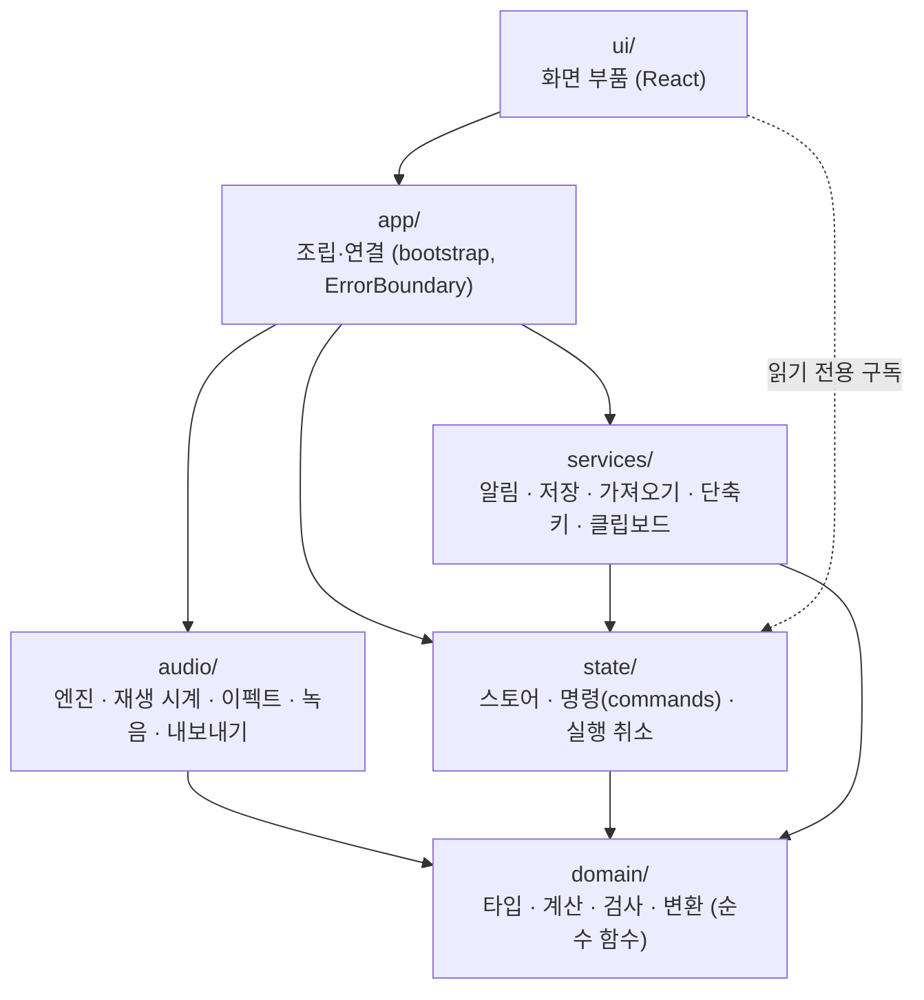
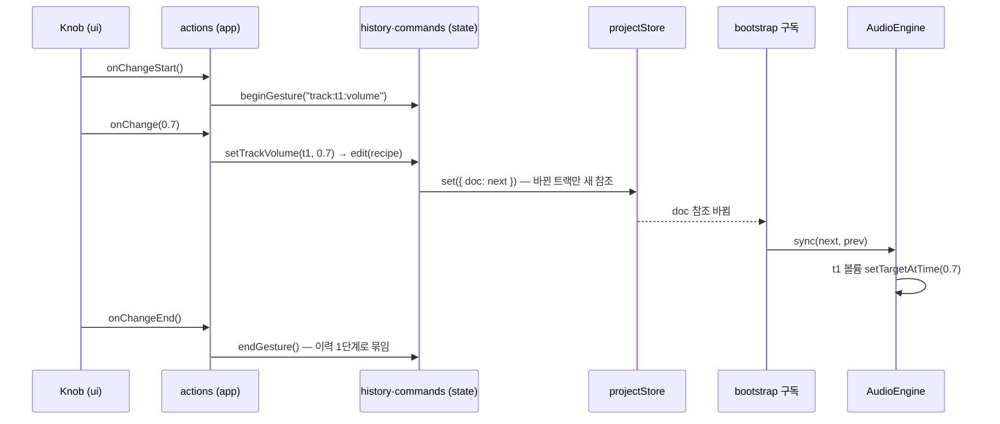
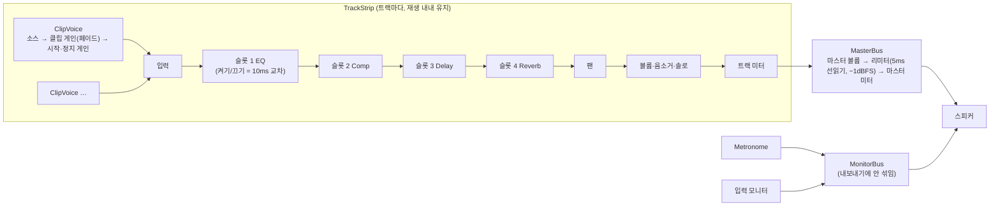
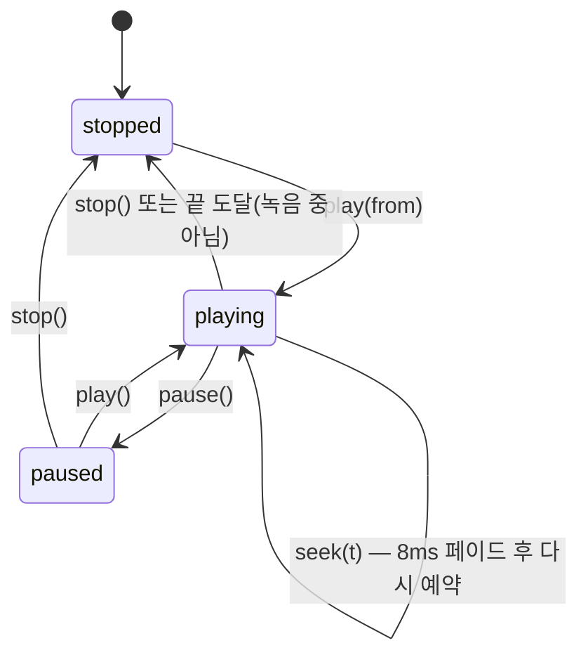
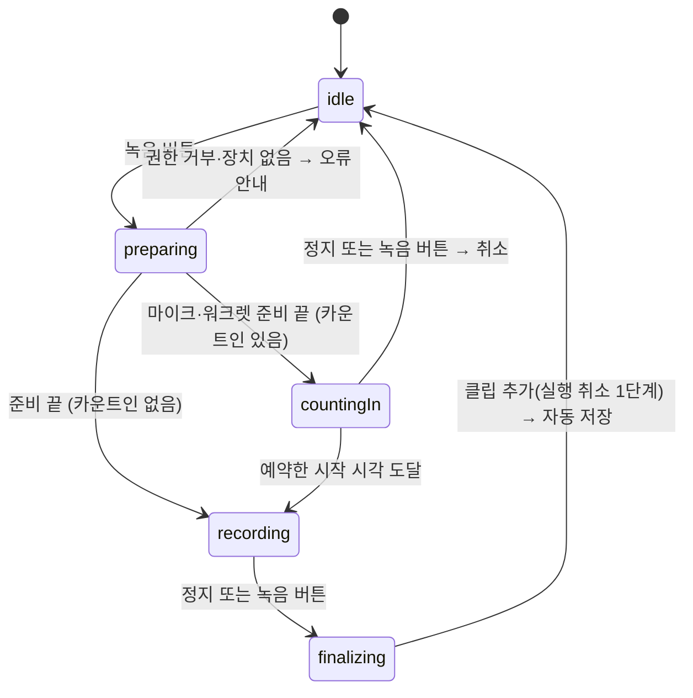

# 반주 디자이너 2 리팩토링 설계서

점검 보고서(2026-11-12)를 바탕으로 한 단계별 실행 설계

| 항목 | 내용 |
|---|---|
| 작성일 | 2026-11-23 |
| 근거 문서 | 「반주 디자이너 2 점검 결과: 수정·보완 목록」(2026-11-12, 38개 항목) |
| 저장소 | `kimyounggaur/Accompany-Designer2nd` |
| 기준 코드 | `master` d79a228 (6월 23일) · `codex/accompany-designer-reliability` 394e8f4 (11월 13일, **아직 master에 병합 안 됨**) |
| 이번에 직접 확인한 것 | 두 브랜치 소스 대조, codex 브랜치 빌드·단위 테스트, 크롬 153 회귀 측정 22개, BPM 감지 단독 시험, 연결된 Vercel 팀 조회 |
| 기존 계획서와의 관계 | 「음원 편집 · 믹싱 · 이펙팅 보강 프롬프트 설계서」의 새 기능은 이 설계의 3단계가 끝난 뒤에 재개합니다(§9) |

---

## 0. 이 문서를 읽는 법

**순서대로 쓰는 문서입니다.** 0단계부터 6단계까지 차례로 진행하고, 각 단계 안의 작업 단위(`P3-2` 같은 번호)는 PR 하나로 끝냅니다.

**표기**

| 표기 | 뜻 |
|---|---|
| `A1`~`D7` | 보고서 항목 번호(그대로 사용) |
| `P2-1` | 이 문서의 작업 단위. 2단계의 1번 작업 |
| ✅ 해결 | 11/13 codex 브랜치에서 해결됨(실측 또는 코드 확인) |
| 🟡 부분 | 증상은 줄었으나 남은 문제가 있음 |
| ❌ 미해결 | 손대지 않음 |
| ❓ 미확인 | 이번에도 확인할 수 없었음 |
| 실측 / 코드 확인 | 보고서와 같은 뜻. 실측은 브라우저에서 재현해 잰 것 |
| 크기 S·M·L | S = 1일 이내, M = 2~4일, L = 1~2주. AI 코딩 도구를 쓰는 1인 기준, 검토·측정 포함 추정치 |

**각 작업 단위의 형식**은 모두 같습니다: 목표 → 대상 항목 → 바꿀 파일 → 절차 → 수용 기준(숫자로) → 테스트 → 위험과 되돌리기.

---

## 1. 요약

**한 줄 결론.** 11월 13일 codex 브랜치가 38개 항목 중 14개를 해결하고 19개를 부분 해결했습니다(브라우저 실측과 코드 확인). 하지만 고친 내용이 `App.tsx`(809줄) 한 파일과 React 효과(useEffect)에 몰려 있어, 다음 기능(오토메이션·센드·사이드체인)을 올릴 바탕은 아직 아닙니다. 그리고 그 변경은 **아직 어디에도 배포되지 않았습니다.** 이 설계는 codex 브랜치를 출발점으로 삼고, 보고서의 권장 순서(6단계)를 그대로 따르면서 단계마다 "증상 수정"을 "구조"로 바꿉니다.

**핵심 판단 다섯 가지**

1. **codex 브랜치는 버리지 말고 기준선으로 병합합니다.** 빌드·타입 검사 통과, 단위 테스트 9개 통과, 라이브러리 취약점 0건, 회귀 측정 16개 통과를 확인했습니다.
2. **가장 먼저 할 일은 여전히 A1(공식 주소 하나)입니다.** master는 6월 23일에 멈춰 있고 codex 변경은 병합 전입니다. 이 대화에 연결된 Vercel 팀(kimyounggaur's projects)에는 프로젝트가 0개라, 배포한 계정이 다른 계정일 가능성이 큽니다.
3. **재생 구조는 "재시작 0회"는 달성했지만 구조는 아직입니다.** 엔진 연결을 React 밖으로 옮기고, 이펙트를 켜고 끌 때도 소리 경로를 유지하고, 클릭 없이 재배치하고, 진짜 리미터를 넣어야 합니다.
4. **이번에 새로 찾은 문제가 넷 있습니다.**
   - 마스터 압축기가 과하게 누릅니다. 0.8 크기 클립 1개의 출력 최대값은 0.66인데, 같은 클립 2개를 겹치면 0.56으로 **오히려 작아집니다**(C8 처리의 부작용).
   - 노브를 키보드로 3번 올리면 1번만 오르고 초점이 사라집니다. 노브 부품이 Inspector 안에서 매번 새로 만들어지기 때문입니다(D6·C12).
   - 이펙트 랙 프리셋 파일은 검사가 거의 없습니다(C11과 같은 종류의 입구).
   - codex 브랜치가 GitHub Pages 배포 워크플로를 새로 넣었습니다. 보고서 결정 1(Vercel 하나만)과 충돌합니다.
5. **측정 → 수정 → 재측정을 자동화합니다.** 보고서의 측정 방법을 그대로 옮긴 회귀 스위트(Playwright 22개)를 0단계에 넣습니다. 아직 못 고친 항목은 "예상 실패"로 표시해 두고, 고치면 표시를 지웁니다. 이 스위트는 이번에 codex 빌드에서 실제로 돌려 검증했습니다(부록 C).

**단계 한눈에 보기**

| 단계 | 이름 | 다루는 보고서 항목 | 크기 | 끝났다는 기준(요약) |
|---|---|---|---|---|
| 0 | 출발점 고정 | 전체 | S~M | codex 병합, 회귀 스위트 "통과 16 / 예상 실패 6" |
| 1 | 배포와 저장소 정리 | A1, D1, D4, D3 | S~M | 운영 주소의 빌드 표시 = master 최신 커밋 |
| 2 | 화면 틀과 데이터 보호 | A2, A4, A6, C6 | M | 상단 바 높이 기준 통과, 안내 통로 하나, 영어 오류 문장 0 |
| 3 | 재생 구조 교체 | A3, B6, B7, B10, C4, C8, D6 | L | 재생 중 편집 시 튐 0회, 리미터 기준 통과, 내보내기 = 재생 |
| 4 | 저장과 편집 정확도 | A5, B1, B2, B3, B4, B5, B8, B9, C11(잔여) | M~L | 음원 포함 파일(.adproj), 재연결 대화상자, 다단계 파형 |
| 5 | 조작 편의 | B11, B12, C1, C2, C3, C5, C7, C10, C13 | M~L | 이력 묶음, 단축키 표 하나, 재생 중 화면 갱신 초당 70회 이하 |
| 6 | 마무리 | C9, C12, D2, D5, D7 | M~L | 스타일 1겹, 접근성 자동 점검 심각·중대 0건, 휴대폰 "재생·녹음" 모드 |

보고서 순서에서 바꾼 곳은 두 군데입니다. **D3(사이트 기본 정보)를 6단계에서 1단계로** 당겼습니다. 비용이 작고, 파비콘 404 오류가 회귀 스위트의 콘솔 오류 검사를 오염시키기 때문입니다. **노브 부품 분리(D6 일부)를 6단계에서 5단계 맨 앞(P5-0)으로** 당겼습니다. 실행 취소 묶음(B12)과 키보드 조작(C12)이 이 부품에 달려 있기 때문입니다.



4단계와 5단계는 서로 기다리지 않아도 됩니다. 다만 P5-1(실행 취소 엔진)은 P4-1(문서 형식)과 같은 파일을 건드리므로 둘 중 하나를 먼저 병합하고 다른 하나를 그 위에서 시작합니다.

---

## 2. 출발점: 11월 13일 codex 브랜치 재측정

### 2.1 무엇을 어떻게 쟀나

| 대상 | 방법 | 결과 |
|---|---|---|
| 소스 차이 | `git diff d79a228 394e8f4` | 34개 파일, +1,869줄 / −1,218줄. 이와 별도로 node_modules 4,601개 파일과 빌드 결과물 삭제 |
| 빌드 | `npm ci && npm run build` (타입 검사 포함) | 통과 |
| 단위 테스트 | `node --import ./tests/register-typescript.mjs --test tests/*.test.mjs` | 9개 모두 통과. 단, `package.json`에 test 명령이 없음 |
| 취약점 | `npm audit` | 0건 (vite 8.3.8) |
| 화면·동작 | 크롬 153(헤드리스) + Playwright 1.63, 회귀 스위트 22개 | 16개 통과, 6개는 아직 미해결로 확인 |
| BPM 감지 | 박자가 정확한 클릭 음원 12종(60~174 BPM) | codex 11종 정확, 174→173. master는 60 실패, 120→117, 140→70 |
| Vercel | 이 대화에 연결된 Vercel 계정의 팀 조회 | 팀 1개, 프로젝트 0개 |

**이번에도 확인하지 못한 것:** 귀로 듣기, 실제 휴대폰·아이폰·사파리·파이어폭스, 실제 마이크 지연, 한글 입력 상태의 단축키, 운영 중인 Vercel 대시보드.

### 2.2 38개 항목의 현재 상태 (codex 브랜치 기준)

master와 운영 주소에는 아래 변경이 하나도 들어 있지 않습니다. 이 표는 "codex 브랜치를 병합하면 출발점이 어디인가"를 보여 줍니다.

**1순위**

| 항목 | 상태 | 근거 | 남은 것 | 담당 |
|---|---|---|---|---|
| A1 운영 주소 뒤처짐 | ❓ | 연결된 Vercel 팀에 프로젝트 0개. codex 미병합 | 운영 브랜치 확인·통일, 빌드 표시 | P1-1, P1-2 |
| A2 오른쪽 패널 밀림 | 🟡 | 실측: 1024~1920px 7종 모두 패널 전체 보임, 가로 넘침 0 | 상단 바가 1440px에서 177px(3줄), 1920px에서 80px로 세로 공간을 많이 씀 | P2-1 |
| A3 재생 통째 재시작 | 🟡 | 실측: 재생 중 볼륨 10단계·이름 8글자에 재시작 0회 | 동기화가 React 효과 + 전체 JSON 직렬화에 묶임. 이펙트 켜기/끄기·순서 변경 시 그 트랙 소리 전부 재시작. 재배치가 페이드 없이 즉시 | P3-1~P3-3 |
| A4 새로고침 시 작업 사라짐 | ✅ | 실측: 새로고침 뒤 클립과 소리 복구, 닫기 전 경고 | 자동 저장이 App.tsx 안에 있고 칸이 1개뿐 | P2-4 |
| A5 다시 열면 소리 없음 | 🟡 | 실측: 자동 저장 복구 후 재생됨. 코드: 저장 파일에 음원을 base64로 넣음 | 파일 크기 약 1.33배, 큰 곡에서 메모리 부담. 재연결이 이름+길이로 말없이 자동 연결 | P4-1, P4-2 |
| A6 안내가 안 보임 | 🟡 | 실측: 도구를 바꾼 뒤에도 업로드 실패 안내가 보임 | 안내 통로가 여전히 둘(status, commandMessage). 복구 안내가 "프로젝트 불러옴"에 덮임(실측). 오류와 일반 안내가 같은 줄 | P2-2 |

**2순위**

| 항목 | 상태 | 근거 | 남은 것 | 담당 |
|---|---|---|---|---|
| B1 자른 클립 파형 | ✅ | 코드: 클립 구간(offset~duration)만 그림 | — (회귀 테스트로 유지) | P4-3 |
| B2 긴 곡 파형·전체 보기 | 🟡 | 코드: 캔버스를 보이는 폭으로 제한, 최소 배율 1px/초 | 파형 점 1,800개 고정 → 확대하면 뭉툭함 그대로. "전체 맞추기" 없음 | P4-3 |
| B3 템포 직접 입력 | ✅ | 실측: 90 입력 → 90. 원본 BPM·소스 BPM 칸도 같은 부품 | — | P4-4 |
| B4 템포 변경 시 속도·음정 | 🟡 | 코드: 새 음원의 WARP 기본값 꺼짐 | WARP를 켜면 음정도 바뀐다는 안내 없음 | P4-4 |
| B5 BPM 감지 | ✅ | 실측: 클릭 음원 12종 중 11종 정확. 적용 전 확인(클립/프로젝트) | 메인 스레드에서 최대 180초 분석(긴 곡에서 멈춤 가능, 미측정) | P4-4 |
| B6 정지해도 녹음 계속 | ✅ | 실측: 정지 버튼이 녹음도 끝냄 | — | P3-5 |
| B7 녹음 겹침·어긋남 | 🟡 | 실측: 빈 트랙(새 트랙)에 놓임. 코드: 녹음 버튼이 반주 재생 시작, 메트로놈 오디오 시계 예약 | 지연 보정 없음(관련 코드 0건). 카운트인은 여전히 타이머. 메트로놈은 녹음 때만 | P3-5 |
| B8 업로드 위치 | ✅ | 코드: 선택 트랙 우선, 겹치면 새 트랙. 실측: 두 번째 업로드가 새 트랙 | 겹침 판정이 원본 길이 기준(WARP 켠 클립에서 오판 가능) | P4-5 |
| B9 기본 도구 | ✅ | 코드: 기본 "이동", 눈금자 클릭 = 재생 위치 이동 | — | P4-6 |
| B10 완성본 내보내기 | 🟡 | 코드: 믹스 WAV(16비트 스테레오) 추가 | 진행률·취소 없음. 리버브 잔향이 매번 무작위라 재생과 내보내기 소리가 미세하게 다름 | P3-6 |
| B11 쉬운 삭제 | ✅ | 코드: 우클릭 → 메뉴 | 메뉴 항목이 "삭제·닫기" 2개뿐 | P5-4 |
| B12 실행 취소가 잘게 쌓임 | 🟡 | 실측: 슬라이더 30단계 끌기 → Ctrl+Z 1번에 복구 | 키보드 조정은 한 단계씩 기록(실측). 묶음 표시가 스토어 밖 변수라 놓치면 이후 편집이 한 덩어리가 될 위험. 단계마다 문서 전체 복사 | P5-1 |

**3순위**

| 항목 | 상태 | 근거 | 남은 것 | 담당 |
|---|---|---|---|---|
| C1 재생선 따라가기 | ✅ | 코드: 켜기/끄기, 확대 후 위치 이동 | 재생선 그리기 구조는 C10과 함께 | P5-3 |
| C2 휠 스크롤·확대 | ✅ | 실측: 콘솔 오류 0. 코드: Ctrl+휠만 확대, 마우스 기준 | — | — |
| C3 단축키 | 🟡 | 코드: 키 위치(code) 기준, Ctrl+C/V/S 연결, Shift+숫자 동작 | 한글 조합 중 처리 없음. 복사·붙여넣기가 App 안에만 있어 메뉴와 따로 놂. 메뉴 표기와 실제 키가 따로 관리됨 | P5-2 |
| C4 곡 끝에서 재생 | ✅ | 실측: 끝에서 재생 → 처음부터 | 재생 시작 직후 불필요한 재시작도 사라짐(실측: 클립 1개에 소스 1개) | P3-2 |
| C5 고해상도 분석기 | ✅ | 코드: CSS 픽셀 좌표 + setTransform | 배율 2 화면 실측은 안 함 | — |
| C6 안 보이는 글자·영어 | 🟡 | 코드: 카운트인·입력 장치·녹음 안내 한국어화, 깨진 "쨌" 수정, 명암 보정 | 브라우저 영어 오류가 그대로 나옴(실측 "Unable to decode audio data"). ARM·M·S·MUTE·SOLO·TRACK MIX·COMPRESSOR 등 영어 라벨 | P2-3 |
| C7 동작 안 하는 조작부 | 🟡 | 코드: 분석기 MODE 버튼 제거, 딜레이 SYNC 시 TIME 노브 비활성 | 컴프레서 바늘은 여전히 Threshold 값. 그룹화는 표시만. 스냅 "라인" = "1/2박" | P5-6 |
| C8 출력 한계 | 🟡 | 코드: 마스터 압축기(−1dB, 20:1) + 0.98 상한. 실측: 넘침은 없음 | **과압축**: 클립 1개 0.66 → 겹친 2개 0.56. 마스터 볼륨 조절 없음 | P3-4 |
| C9 휴대폰·터치 | ❌ | 실측: 390px에서 내용 폭 415px, 상단 바 419px, 타임라인 210px | 결정 2대로 다음 단계 | P6-5 |
| C10 계속 도는 화면 갱신 | 🟡 | 실측: 정지 상태 화면 갱신 0회/초 | 재생 중 초당 약 180회(루프 3개). 재생 중 타임라인·상단 바 전체를 매 프레임 다시 그림(코드) | P5-3 |
| C11 잘못된 파일 수용 | ✅ | 코드+단위 테스트: 형식 검사, 버전 번호, 덮어쓰기 전 확인, URL 값 버림 | **추가 발견**: 이펙트 프리셋 파일은 `effectChain` 길이만 검사 | P4-1 |
| C12 접근성 | 🟡 | 코드: 버튼·입력 이름, 클립 tabIndex, 일부 노브 slider 역할 | **실측(새 발견)**: 노브 키보드 3회 → 1회만 오르고 초점 사라짐. 24px 미만 버튼, axe 재점검 안 함 | P5-0, P6-2 |
| C13 기본 편집 기능 | 🟡 | 코드: 트랙 삭제·순서 바꾸기, Ctrl+C/V | 재생선에서 자르기, 여러 클립 함께 옮기기, 마디 스냅, 끌어다 놓기 업로드, 박자표 | P5-5 |

**4순위**

| 항목 | 상태 | 근거 | 남은 것 | 담당 |
|---|---|---|---|---|
| D1 저장소 불필요 파일 | 🟡 | 코드: node_modules·빌드 결과·로그·개인 설정 삭제, .gitignore 채움 | "00 Source"/"Source" 중복과 타사 캡처, `.claude/launch.json`, 쓰지 않는 `src/assets/icons/flicon_*` 13개, 기본 브랜치 main(4월 코드), 과거 이력의 103MB | P1-3 |
| D2 타사 이름·아이콘 | 🟡 | 코드: 도구 아이콘을 자체 SVG로, REV PLATE-140·Specan 32 문구 교체 | 저장소의 타사 캡처·docx, 코드 이름(`reverb-arturia-mark`), 쓰지 않는 flicon 파일 | P1-3, P6-3 |
| D3 사이트 기본 정보 | ❌ | 코드: 제목 "Browser DAW MVP", 파비콘 없음, 패키지 이름 browser-daw-mvp | 전부 | P1-6 |
| D4 라이브러리 버전 | ✅ | 실측: 버전 숫자 고정, 취약점 0건 | 업데이트 알림(Dependabot) 없음 | P1-4 |
| D5 스타일 3겹 | ❌ | 코드: 3,922줄(50줄 추가) | 전부 | P6-1 |
| D6 코드 구조·안전망 | 🟡 | 코드: 단위 테스트 9개 | test 명령·CI 없음, 화면 오류 안내 장치 없음, ScriptProcessorNode 그대로, 노브 재생성 그대로, App.tsx 809줄 | P0-3, P3-0, P3-5, P5-0 |
| D7 긴 음원 메모리 | ❌ | 코드: 크기·길이 상한 없음 | 전부 | P6-4 |

**합계:** ✅ 14 · 🟡 19 · ❌ 4 · ❓ 1 = 38

### 2.3 codex 브랜치에 남은 구조 문제

아래는 "지금은 동작하지만 다음 작업을 막는" 문제입니다. 리팩토링이 필요한 이유이기도 합니다.

| # | 문제 | 위치(394e8f4 기준) | 왜 문제인가 | 해결 단계 |
|---|---|---|---|---|
| S1 | `App.tsx`가 9가지 일을 함: 재생, 녹음 상태 관리, 메트로놈, 카운트인, 업로드·재연결, 저장·불러오기·내보내기, 자동 저장·복구, 단축키, 클립보드 | `src/App.tsx` 809줄 | 한 곳을 고치면 다른 흐름이 깨지기 쉽고 단위 테스트가 불가능 | P2-2, P2-4, P3-5, P5-2 |
| S2 | 엔진 동기화가 React 효과에 묶임 | `App.tsx`의 `schedulingSignature = JSON.stringify({bpm, tracks})`, `audioEngine.sync()`의 클립별 `JSON.stringify` | 변경마다 문서 전체 직렬화. 화면 그리기 시점에 소리 반영이 끌려다님 | P3-1 |
| S3 | 스토어 갱신이 안 바뀐 트랙도 새 객체로 만듦 | `useDawStore.ts`의 `tracks.map((track) => ({ ...track, clips: … }))` 패턴 | "무엇이 바뀌었나"를 참조 비교로 알 수 없어 매번 전부 비교해야 함 | P3-1 |
| S4 | 이펙트 켜기/끄기·순서 변경 = 트랙 그래프 새로 만들기 | `audioEngine.ts`의 `graphSignature` → `createTrackGraph` + 그 트랙 소스 전부 정지 | 재생 중 끊김. 오토메이션·센드를 올리면 더 잦아짐 | P3-3 |
| S5 | 재배치가 페이드 없이 즉시 정지·시작 | `stopSource()` → `scheduleClip()` | 클릭(톡) 소리 가능 | P3-2 |
| S6 | 리버브 잔향(IR)이 `Math.random`으로 매번 새로 생성, 잔향 길이 노브를 끄는 동안 계속 재생성 | `reverb.ts` `createImpulseResponse`, `update()` | 재생과 내보내기 소리가 다름. 노브 조작 중 버벅임 | P3-3 |
| S7 | 마스터 압축기 과압축 | `audioEngine.ts` `ensureContext()` (threshold −1, ratio 20) + `createSafetyCeiling` | 겹칠수록 작아짐(실측). 브라우저 압축기는 자동 보정 이득이 있어 결과 음량을 정확히 제어하기 어려움 | P3-4 |
| S8 | 실행 취소 묶음 표시가 스토어 밖 변수 | `useDawStore.ts`의 `groupingHistory`, `groupRecorded` | pointerup을 놓치면 이후 편집이 계속 한 단계로 묶임 | P5-1 |
| S9 | 이력 한 단계마다 문서 전체를 JSON 복사(파형 점 1,800개 × 음원 수 포함) | `cloneHistorySnapshot` | 음원이 많을수록 느려지고 메모리 증가 | P4-1, P5-1 |
| S10 | 안내 통로 둘 + 효과로 맞춤 | `useEffect(() => { if (commandMessage) setStatus(commandMessage) })` | 나중 안내가 먼저 안내를 덮음(실측) | P2-2 |
| S11 | 노브 부품을 Inspector 함수 안에서 정의 | `Inspector.tsx`의 `EqKnob`, `TraxKnob`, `CompKnob` | 그릴 때마다 새 부품 → 초점 사라짐(실측) | P5-0 |
| S12 | 재생 중 매 프레임 `setPlayhead` | `App.tsx` tick, `Timeline`·`TransportBar`가 playhead 구독 | 재생 중 화면 전체를 매 프레임 다시 그림 | P5-3 |
| S13 | 녹음 중 파형을 문서에 초당 약 12회 기록 | `startRecording()`의 `onPeaks` → `updateAudioAsset`·`updateClip` | 엔진 동기화·자동 저장 판단이 녹음 내내 돎 | P3-5 |
| S14 | 저장 파일이 base64 JSON | `projectStorage.ts` `exportProject` | 크기 1.33배, 큰 문자열 메모리 | P4-2 |
| S15 | 안전망 부족: test 명령·CI·오류 안내 장치 없음 | `package.json`, `main.tsx` | 리팩토링 중 회귀를 늦게 발견 | P0-3, P1-5, P3-0 |

---

## 3. 리팩토링 원칙

모든 작업 단위에 적용하는 규칙입니다. AI 코딩 도구에 줄 공통 지시(§10)에도 그대로 들어갑니다.

1. **측정이 먼저입니다.** 작업 시작 전과 후에 회귀 스위트를 돌려 숫자를 PR에 남깁니다.
2. **작업 단위 하나 = PR 하나.** 되돌리기 쉽게 작게 나눕니다. 한 PR에서 구조 변경과 기능 추가를 섞지 않습니다.
3. **기능 동결.** 3단계가 끝날 때까지 새 이펙트·오토메이션·센드를 넣지 않습니다(보고서 권고).
4. **동작 보존.** 사용자가 쓰는 동작은 바꾸지 않습니다. 결정 사항으로 바꾸는 것은 PR 설명에 "동작 변경"이라고 적습니다.
5. **한 방향 흐름.** 화면 → 명령(commands) → 문서 → (구독) → 엔진·자동 저장. 엔진에서 화면으로는 "시계 읽기"만 합니다.
6. **문서와 화면 상태를 나눕니다.** 실행 취소와 자동 저장 대상은 문서뿐입니다. 선택·도구·확대·재생 위치는 문서가 아닙니다.
7. **바깥 데이터는 한 검사기를 거칩니다.** 프로젝트 파일, 자동 저장, 프리셋 모두 같은 `parse…` 함수를 씁니다.
8. **무거운 계산은 Worker, 실시간 소리는 AudioWorklet.** 메인 스레드에서 200ms 넘는 작업을 만들지 않습니다.

---

## 4. 목표 구조

### 4.1 계층과 의존 방향

위에서 아래로만 가져다 씁니다(import). 아래 계층은 위 계층을 모릅니다.



- `domain/`은 React도 Web Audio도 모릅니다. 그래서 Node 단위 테스트로 전부 검사할 수 있습니다.
- `ui/`는 엔진을 직접 부르지 않습니다. `app/`이 만든 명령 함수(예: `transport.toggle()`)만 부릅니다.
- `state/`의 스토어 갱신 함수는 안내 문구를 만들지 않습니다. 결과를 돌려주고, 안내는 `app/actions`가 `services/notify`로 합니다.

### 4.2 폴더 구조

```text
src/
  app/
    main.tsx                 # 진입점 (현재 src/main.tsx)
    App.tsx                  # 화면 조립만. 목표 120줄 이하
    AppShell.tsx             # 상단 바 / 작업 영역 / 상태 줄 격자
    bootstrap.ts             # 엔진·스토어·자동 저장·단축키 연결과 해제
    actions.ts               # 화면이 부르는 명령(재생, 저장, 자르기 …) — 안내는 여기서
    ErrorBoundary.tsx
  domain/
    types.ts                 # ProjectDoc, Track, Clip, AssetMeta …
    project/
      defaults.ts            # 기본 트랙·기본 이펙트 값
      parseProject.ts        # 검사 + 기본값 채우기 + 범위 보정 (파일·자동 저장 공통)
      parsePreset.ts         # 이펙트 프리셋 검사
      migrations.ts          # v0(6월 JSON) → v1(11월 JSON) → v2
    timeline/
      clipMath.ts            # 재생 배율, 타임라인 길이, 자르기, 겹침
      snap.ts                # 마디·박·1/2·1/4·없음
      placement.ts           # 업로드·녹음 클립을 어느 트랙에 놓을지
      toolBehavior.ts        # 도구별 클릭·끌기 동작 표
    tempo/
      bpmDetector.ts
  state/
    projectStore.ts          # 문서(되돌리기 대상)
    sessionStore.ts          # 선택, 도구, 확대, 스냅, 편집 커서, 패널 상태
    recordingStore.ts        # 녹음 단계, 임시 파형
    noticeStore.ts           # 안내 목록
    history.ts               # immer 패치 기반 실행 취소 + 묶음
    commands/                # 문서 바꾸는 함수 모음 (clip.ts, track.ts, project.ts …)
  audio/
    engine/
      AudioEngine.ts         # 바깥에 공개하는 창구
      Transport.ts           # 재생 시계 (재생·일시정지·정지·이동, 지연 보정)
      Scheduler.ts           # 25ms 틱, 2초 선읽기 (Worker 타이머)
      ClipVoice.ts           # 클립 1개 재생 단위 (클릭 없는 시작·정지)
      TrackStrip.ts          # 트랙마다 고정된 소리 경로
      MasterBus.ts           # 마스터 볼륨 + 리미터 + 미터
      MonitorBus.ts          # 메트로놈·입력 모니터 (내보내기에 안 섞임)
      graphSync.ts           # 문서 변화 → 노드 값 반영
      OfflineRenderer.ts     # 믹스 WAV 내보내기 (같은 TrackStrip 사용)
    effects/
      EffectNode.ts          # 공통 약속(인터페이스)
      Eq5Band.ts  Compressor.ts  Delay.ts  Reverb.ts
      impulse.ts             # 시드 고정 잔향 생성
      registry.ts            # 이펙트 종류 → 만드는 함수
    worklets/
      recorder.worklet.ts    # 녹음
      limiter.worklet.ts     # 선읽기 리미터
      probe.worklet.ts       # 출력 측정 (개발용, ?probe=1)
    recording/
      Recorder.ts  latency.ts
    Metronome.ts
    workers/
      tick.worker.ts         # 예약기 타이머
      peaks.worker.ts        # 다단계 파형
      bpm.worker.ts          # BPM 감지
      wav.worker.ts          # WAV 인코딩
  services/
    notify.ts                # notify(), notifyError()
    errors.ts                # 브라우저 오류 → 한국어 문구
    persistence/
      db.ts                  # IndexedDB v2: projects / assets / peaks / meta
      autosave.ts
      projectFile.ts         # .adproj 내보내기·읽기
    importer.ts              # 업로드, 크기 상한, 재연결
    shortcuts.ts             # 단축키 표 + 처리기
    clipboard.ts
    peaksCache.ts            # 파형 캐시 (IndexedDB peaks)
    frameLoop.ts             # 화면 갱신 루프 하나
  ui/
    transport/  timeline/  inspector/  controls/  feedback/  dialogs/
  i18n/
    ko.ts                    # 사용자 문구 전부
  styles/
    tokens.css  base.css  layout.css   # 컴포넌트 스타일은 각 부품 폴더에
```

**현재 파일이 옮겨 갈 곳**

| 현재 (394e8f4) | 목표 | 옮기는 작업 |
|---|---|---|
| `src/App.tsx` (809줄) | `app/App.tsx`, `app/bootstrap.ts`, `services/*`, `audio/recording/*`, `state/commands/*` | P2-2, P2-4, P3-1, P3-5, P5-2 |
| `src/store/useDawStore.ts` (1,180줄) | `state/projectStore.ts`, `state/sessionStore.ts`, `state/recordingStore.ts`, `state/history.ts`, `state/commands/*`, `domain/project/defaults.ts` | P3-1, P4-1, P5-1 |
| `src/audio/audioEngine.ts` (541줄) | `audio/engine/*`, `audio/effects/*` | P3-1~P3-6 |
| `src/storage/projectStorage.ts` | `domain/project/parseProject.ts`, `services/persistence/*` | P2-4, P4-1, P4-2 |
| `src/components/Inspector.tsx` (755줄) | `ui/inspector/*Panel.tsx` + `ui/controls/Knob.tsx` | P2-1, P5-0 |
| `src/components/TransportBar.tsx` | `ui/transport/*` (재생 묶음·녹음 옵션·템포·확대·파일 메뉴) | P2-1 |
| `src/components/Timeline.tsx`, `ClipView.tsx` | `ui/timeline/*` (+ `PlayheadOverlay`, `WaveformCanvas`) | P4-3, P5-3 |
| `src/styles.css` (3,922줄) | `styles/*` + 부품별 CSS | P6-1 |

### 4.3 데이터 흐름

**편집이 소리에 닿는 길** (예: 재생 중 볼륨 노브를 돌림)



**소리가 화면에 닿는 길:** 엔진은 스토어에 쓰지 않습니다. 재생선·시간 표시·미터는 `frameLoop`가 재생 중에만 `engine.transport.visualPosition()`과 분석기를 읽어 DOM에 직접 그립니다(React 상태를 거치지 않음).

**자동 저장:** `projectStore`의 `doc` 참조가 바뀌면 1.2초 뒤 저장, 탭을 숨기거나 닫을 때는 즉시 저장. 녹음 중에는 문서가 바뀌지 않으므로(녹음 파형은 `recordingStore`) 저장도 돌지 않습니다.

### 4.4 상태 나누기

| 저장소 | 담는 것 | 실행 취소 | 자동 저장 | 바뀌는 빈도 |
|---|---|---|---|---|
| `projectStore.doc` | 이름, 템포, 박자표, 트랙, 클립, 음원 정보(파형 제외), 마커, 마스터 설정 | 예 | 예 | 편집할 때 |
| `sessionStore` | 선택, 도구, 스냅, 확대, 스크롤, 편집 커서, 따라가기, 패널 접힘 | 아니요 | 아니요(일부는 localStorage) | 조작할 때 |
| 엔진 `Transport` | 재생 상태, 재생 위치 | 아니요 | 아니요 | 매 순간 (스토어에 없음) |
| `recordingStore` | 녹음 단계, 대상 트랙, 경과 시간, 임시 파형 | 아니요 | 아니요 | 녹음 중 초당 20회 |
| `noticeStore` | 안내 목록 | 아니요 | 아니요 | 안내할 때 |
| IndexedDB `peaks` | 음원별 다단계 파형 | — | 캐시 | 음원 추가 시 1회 |

**파형 점(`waveformPeaks`)을 문서에서 빼는 것**이 중요한 변화입니다. 파형은 음원에서 다시 만들 수 있으므로 실행 취소 이력, 자동 저장, 프로젝트 파일에 넣을 이유가 없습니다(S9 해결).

### 4.5 목표 오디오 경로



- 이펙트 슬롯 순서를 바꿀 때만 연결을 다시 하고, 그때도 볼륨을 10ms 내렸다 올려 클릭을 막습니다.
- 내보내기는 같은 `TrackStrip`·`MasterBus` 클래스를 `OfflineAudioContext` 위에 만들어 씁니다. 그래서 재생과 내보내기 소리가 같습니다.

### 4.6 핵심 약속(인터페이스)

아래 코드는 설계 기준입니다. 이름과 모양을 지키되 내부 구현은 작업 단위에서 정합니다.

```ts
// src/domain/types.ts (일부) — 문서 형식 v2
export type AssetId = string;
export interface AssetMeta {
  id: AssetId;
  fileName: string;
  duration: number;
  sampleRate: number;
  channels: number;
  source: "upload" | "recording";
  hash?: string;          // SHA-256. 같은 파일 판별·재연결에 사용
  mimeType?: string;
  byteSize?: number;
  detectedBpm?: number;
  recordedAt?: string;
  // waveformPeaks 없음: IndexedDB peaks 캐시로 이동
}
export interface ProjectDoc {
  schemaVersion: 2;
  id: string;
  name: string;
  bpm: number;
  timeSignature: { beats: number; unit: 4 | 8 };   // C13 박자표
  sampleRate: number;
  master: { volumeDb: number };                    // C8 마스터 볼륨
  tracks: Track[];
  assets: Record<AssetId, AssetMeta>;
  markers: TimeMarker[];
}
```

```ts
// src/audio/effects/EffectNode.ts — 모든 이펙트가 지킬 약속
export interface EffectEnv { bpm: number; sampleRate: number }
export interface EffectNode<S> {
  readonly type: EffectSlotType;
  readonly input: AudioNode;
  readonly output: AudioNode;
  /** 값만 바꾼다. 연결은 바꾸지 않는다. at = 적용 시각(context 시간) */
  update(settings: S, env: EffectEnv, at: number): void;
  /** 켜기/끄기. 원음과 효과음을 10ms 동안 교차시킨다. 소리 소스는 건드리지 않는다. */
  setBypassed(bypassed: boolean, at: number): void;
  /** 소리가 멈춘 뒤 남는 꼬리 길이(초). 내보내기 길이 계산용 */
  tailSeconds(settings: S, env: EffectEnv): number;
  dispose(): void;
}
```

```ts
// src/audio/engine/Transport.ts — 재생 시계
export type TransportState = "stopped" | "playing" | "paused";
export interface Transport {
  readonly state: TransportState;
  /** 끝에 있으면 0부터 (C4). atContextTime을 주면 그 오디오 시각에 정확히 시작 (카운트인용) */
  play(from?: number, options?: { atContextTime?: number }): Promise<void>;
  pause(): void;
  stop(): void;                         // 처음으로
  seek(position: number): void;         // 재생 중이면 클릭 없이 다시 예약
  position(): number;                   // 지금 예약·처리 중인 타임라인 위치(초)
  visualPosition(): number;             // 출력 지연을 뺀, 지금 들리는 위치(화면용)
  contextTimeAt(position: number): number;
  positionAt(contextTime: number): number;
  on(event: "state" | "ended", listener: () => void): () => void;
}
```

```ts
// src/audio/engine/AudioEngine.ts — 바깥에 공개하는 창구
export interface AudioEngine {
  readonly transport: Transport;
  /** 사용자 동작 안에서 호출. AudioContext 시작과 워크렛 모듈 로드 */
  ensureRunning(): Promise<void>;
  loadAsset(id: AssetId, data: Blob): Promise<{ duration: number; sampleRate: number; channels: number }>;
  hasAsset(id: AssetId): boolean;
  unloadAsset(id: AssetId): void;
  /** 문서 → 소리 경로. 참조가 같은 트랙·클립은 건너뛴다. 재생을 다시 시작하지 않는다 */
  sync(doc: ProjectDoc, prev?: ProjectDoc): void;
  meters(): { master: AnalyserNode; track(id: string): AnalyserNode | undefined; reduction(id: string): number };
  render(doc: ProjectDoc, options: { onProgress?(ratio: number): void; signal?: AbortSignal }): Promise<Blob>;
  dispose(): void;
}
```

```ts
// src/state/history.ts — 실행 취소
export interface HistoryApi {
  /** 문서를 바꾼다. 바뀐 것이 없으면 기록하지 않는다. key가 같고 800ms 안이면 한 단계로 묶는다 */
  edit(label: string, recipe: (draft: Draft<ProjectDoc>) => void, options?: { key?: string; record?: boolean }): boolean;
  beginGesture(key: string): void;      // 끌기·입력 시작
  endGesture(): void;                   // 끌기·입력 끝 (2초 동안 소식 없으면 자동으로 끝)
  undo(): boolean;
  redo(): boolean;
  canUndo(): boolean;
  canRedo(): boolean;
}
```

```ts
// src/services/notify.ts — 안내 통로 하나
export type NoticeLevel = "info" | "success" | "warning" | "error";
export interface Notice {
  id: string;
  level: NoticeLevel;
  message: string;                       // i18n/ko.ts 문구
  detail?: string;                       // 개발용 원문 (접힌 상태로 표시)
  action?: { label: string; run: () => void };   // 예: "되돌리기"
  sticky: boolean;                       // 오류는 기본 true
  count: number;                         // 같은 안내 반복 횟수
}
export function notify(level: NoticeLevel, message: string, options?: Partial<Notice>): void;
export function notifyError(error: unknown, context: ErrorContext): void;   // 오류 → 한국어 문구
```

---

## 5. 먼저 확정할 결정

보고서의 결정 1~6은 **보고서 추천안 그대로** 채택하는 것을 전제로 설계했습니다. 리팩토링 때문에 새로 생긴 결정 7~10을 덧붙입니다. 결정은 `docs/decisions/` 에 한 쪽 이하로 기록합니다(P0-2).

| 번호 | 결정 | 이 설계의 전제(추천) | 다르게 정하면 바뀌는 곳 | 늦어도 |
|---|---|---|---|---|
| 1 | 공식 주소·브랜치 | Vercel 하나. master를 기본 브랜치로. GitHub Pages 끔. **codex 브랜치의 `.github/workflows/pages.yml`과 `build:pages` 삭제** | Pages를 유지하면 P1-2 대신 두 주소의 빌드 표시를 맞추는 검사 추가 | 1단계 시작 |
| 2 | 지원 화면 | 노트북(1280px 이상) 먼저, 휴대폰은 "재생·녹음만"을 6단계에 | P6-5 범위 | 2단계 시작 |
| 3 | 올린 음원의 속도 | 기본 원본 속도(WARP 꺼짐). BPM 감지 후 "프로젝트 템포로 맞추기" 선택(codex에 이미 있음) | P4-4 | 4단계 |
| 4 | 기본 도구 | "이동". 빈 곳·눈금자 클릭 = 재생 위치 이동(codex에 이미 있음) | P4-6 | 4단계 |
| 5 | 저장 방식 | 브라우저 자동 저장(음원 포함) + 음원을 담은 프로젝트 파일 | P2-4, P4-2 | 2단계 |
| 6 | 타사 이름·아이콘 | 자체 이름·아이콘으로 교체 | P1-3, P6-3 | 1단계 |
| 7 | **codex 브랜치를 기준선으로 쓸지** | 예. 검토 후 master에 병합 | 쓰지 않으면 2.2표의 ✅·🟡 항목을 master에서 다시 고쳐야 함(각 단계 분량 약 1.5배, 추정) | 0단계 |
| 8 | **새 라이브러리 허용** | 실행용: `immer`(실행 취소 패치), `fflate`(프로젝트 파일 zip). 개발용: `@playwright/test`, `@axe-core/playwright` | immer 없이: 직접 만든 구조 공유 갱신 함수 + 스냅샷 이력. fflate 없이: 자체 바이너리 묶음 형식(P4-2의 대안) | 개발용 0단계, 실행용 3단계 |
| 9 | **프로젝트 파일 형식** | `.adproj` = 압축하지 않은 zip(project.json + audio/). 옛 JSON 두 형식은 계속 읽음 | JSON 유지 시 P4-2 축소, 큰 곡 메모리 문제는 남음 | 4단계 |
| 10 | **엔진 교체 방식** | 새 엔진을 주소 옵션(`?engine=v2`)으로 나란히 두고, 3단계 수용 기준을 통과하면 기본값 전환, 1주 뒤 옛 엔진 삭제 | 한 번에 교체하면 되돌리기가 PR 단위 revert뿐 | 3단계 시작 |

---

## 6. 단계별 작업

### 0단계. 출발점 고정 (크기 S~M)

**목표:** 모두가 같은 코드, 같은 측정 숫자에서 출발합니다.
**끝났다는 기준:** master = codex 변경 포함, `npm test` 22개 통과, `npm run test:e2e` 22개 결과가 "통과 16 / 예상 실패 6".

#### P0-1. codex 브랜치 검토와 병합 (S) — 결정 7

- **바꿀 것:** 브랜치 병합만. 코드 수정 없음(Pages 워크플로 삭제는 P1-2).
- **절차**
  1. GitHub에서 `codex/accompany-designer-reliability` → `master` PR을 엽니다. 제목 예: `기준선: 11/13 안정화 변경 병합`.
  2. 로컬에서 확인합니다.
     ```bash
     git fetch origin
     git switch -c review/codex origin/codex/accompany-designer-reliability
     npm ci
     npm run build
     node --import ./tests/register-typescript.mjs --test tests/*.test.mjs
     ```
  3. PR 본문에 아래 검토 목록을 붙이고 하나씩 확인합니다.
     - [ ] 빌드·단위 테스트 9개 통과
     - [ ] 저장 형식 `format: "accompany-designer-project", version: 1`은 바꾸지 않음(v2가 이 형식을 읽어야 함, P4-1)
     - [ ] `window.confirm` 2곳(불러오기 덮어쓰기, 트랙 삭제) 위치 기록 → P2-2에서 대화상자 부품으로 교체
     - [ ] App.tsx에 새로 들어온 자동 저장·재연결·클립보드 코드 위치 기록 → P2-4, P4-2, P5-5에서 분리
  4. 병합 방식은 "merge commit"을 씁니다. 문제가 생기면 이 커밋 하나를 revert하면 됩니다.
- **수용 기준:** master에서 빌드 통과, 단위 테스트 9개 통과.
- **위험:** 없음에 가깝습니다. codex 커밋의 부모가 master 최신(d79a228)과 같아 충돌 없이 병합됩니다(확인함).

#### P0-2. 결정 기록 (S)

- **바꿀 파일:** `docs/decisions/0001-official-url.md` … `0010-engine-rollout.md` (§5 표의 10개), 그리고 이 설계서를 `docs/refactoring-design.md`로 넣습니다(§10의 AI 지시문이 이 경로를 가리킴).
- **형식**
  ```md
  # 0001 공식 주소와 브랜치
  - 상태: 확정 (2026-11-__)
  - 결정: Vercel 주소 하나만 공식으로 쓴다. 기본 브랜치는 master. GitHub Pages는 끈다.
  - 이유: 주소가 둘이면 버전이 어긋난다(보고서 A1).
  - 영향: P1-1, P1-2. Pages 주소는 더 이상 열리지 않는다.
  ```
- **수용 기준:** 10개 파일이 있고, 각 작업 단위의 PR 설명이 해당 결정 번호를 적습니다.

#### P0-3. 회귀 측정 스위트 도입 (M) — D6

보고서가 손으로 잰 측정을 자동으로 다시 재는 장치입니다. 이후 모든 PR의 "전/후" 숫자는 여기서 나옵니다.

- **바꿀 파일:** `package.json`, `playwright.config.ts`(새), `e2e/report-regression.spec.ts`(새), `scripts/make-fixtures.mjs`(새), `tests/bpmDetector.test.mjs`(새)
- **절차**
  1. 개발용 라이브러리를 설치합니다(결정 8).
     ```bash
     npm i -D @playwright/test@1.63.0
     npx playwright install chromium
     ```
  2. `package.json`에 명령을 추가합니다.
     ```json
     {
       "scripts": {
         "check": "tsc --noEmit",
         "test": "node --import ./tests/register-typescript.mjs --test tests/*.test.mjs",
         "test:e2e": "node scripts/make-fixtures.mjs && playwright test",
         "test:e2e:report": "playwright show-report"
       }
     }
     ```
  3. 부록 C의 `playwright.config.ts`, `scripts/make-fixtures.mjs`, `e2e/report-regression.spec.ts`, `tests/bpmDetector.test.mjs`를 그대로 넣습니다. 생성된 `e2e/fixtures/`는 커밋해도 되고(1.4MB) `.gitignore`에 넣어도 됩니다.
  4. 결과를 `docs/baseline-2026-11.md`에 기록합니다(부록 D의 숫자).
  5. (권장) 화면 부품에 `data-testid`를 붙이고 스펙의 선택자 표 `S`만 바꿉니다. CSS 이름은 6단계에서 바뀌므로, 클래스 이름에 기대는 선택자는 그때 깨집니다.
     | 부품 | data-testid |
     |---|---|
     | 재생/일시정지, 정지, 녹음 | `transport-play`, `transport-stop`, `transport-record` |
     | 업로드 입력, 템포 입력 | `upload-input`, `tempo-input` |
     | 오른쪽 패널, 상단 바, 상태 줄 | `inspector`, `topbar`, `status-line` |
     | 클립, 트랙 머리, 트랙 볼륨, 트랙 이름 | `clip`, `track-header`, `track-volume`, `track-name` |
     | 눈금자, 시간 표시 | `ruler`, `time-display` |
- **"예상 실패" 표시의 뜻:** 아직 못 고친 항목은 테스트 첫 줄에 `test.fail(true, "P2-1에서 해결 예정 …")`이 있습니다. 이 테스트는 실패해야 "통과"로 셉니다. 고쳐서 테스트가 성공하면 오히려 빨간불이 켜지므로, 그때 그 한 줄을 지우면 해결이 기록됩니다.
- **수용 기준:** `npm test` 22개 통과(기존 9 + BPM 13). `npm run test:e2e` 22개 모두 통과 표시, 그중 6개는 예상 실패.
- **검증 상태:** 이 스위트와 BPM 테스트는 이번에 codex 빌드에서 직접 돌려 위 결과를 확인했습니다.

---

### 1단계. 배포와 저장소 정리 (A1, D1, D4, D3) (크기 S~M)

**목표:** 고친 내용이 실제 주소에 닿는지 눈으로 확인할 수 있게 합니다.
**끝났다는 기준:** 운영 주소의 빌드 표시가 master 최신 커밋과 같음, 공식 주소 1개, 모든 PR에 CI 결과와 미리보기 주소가 붙음.

#### P1-1. 운영 브랜치와 빌드 표시 (S) — A1

- **바꿀 파일:** `vite.config.ts`, `src/vite-env.d.ts`, 상태 줄 부품(지금은 `TransportBar.tsx`, P2-1 이후 `ui/feedback/StatusLine.tsx`)
- **절차 (대시보드)**
  1. **어느 Vercel 계정인지 찾습니다.** 이 대화에 연결된 팀(kimyounggaur's projects)에는 프로젝트가 0개였습니다. vercel.com에서 계정·팀을 바꿔 가며 이 저장소와 연결된 프로젝트를 찾습니다.
  2. 프로젝트 설정의 Git 항목에서 **Production Branch를 `master`** 로 바꿉니다.
  3. 빌드 설정에서 **Node.js 버전을 22.x 이상**으로 맞춥니다(`package.json`의 `engines: >=22.12.0`).
  4. GitHub 저장소 설정에서 **Default branch를 `master`** 로 바꿉니다. 옛 main은 태그로 남긴 뒤 지웁니다.
     ```bash
     git tag archive/main-2026-04 origin/main
     git push origin archive/main-2026-04
     git push origin --delete main
     ```
  메뉴 이름은 화면을 직접 보지 못해 조금 다를 수 있습니다.
- **절차 (코드): 빌드 표시**
  ```ts
  // vite.config.ts
  import { defineConfig } from "vite";

  export default defineConfig({
    base: "/",
    define: {
      __BUILD_COMMIT__: JSON.stringify((process.env.VERCEL_GIT_COMMIT_SHA ?? "local").slice(0, 7)),
      __BUILD_TIME__: JSON.stringify(new Date().toISOString()),
    },
  });
  ```
  ```ts
  // src/vite-env.d.ts 에 추가
  declare const __BUILD_COMMIT__: string;
  declare const __BUILD_TIME__: string;
  ```
  상태 줄 오른쪽 끝에 `빌드 a1b2c3d`를 작은 글씨로 보이고, 마우스를 올리면 빌드 시각을 보입니다. Vercel은 빌드할 때 `VERCEL_GIT_COMMIT_SHA` 같은 시스템 환경 변수를 넣어 줍니다(설정에서 꺼져 있으면 켭니다).
- **수용 기준:** master에 커밋 → 운영 주소의 빌드 표시 = `git rev-parse --short HEAD`. PR마다 미리보기 주소가 생김.
- **되돌리기:** Vercel의 이전 배포로 되돌리기(Instant Rollback).

#### P1-2. GitHub Pages 정리 (S) — 결정 1

- **바꿀 파일:** `.github/workflows/pages.yml` 삭제, `package.json`의 `build:pages` 삭제, `README.md`
- **절차:** GitHub 설정의 Pages를 끕니다. README 첫 줄에 공식 주소 하나만 적습니다.
- **선택:** Pages 주소를 이미 알린 사람이 있다면, 끄기 전에 "주소가 바뀌었습니다 → 새 주소" 안내 페이지 한 장을 2~4주 동안 올려 둡니다.
- **수용 기준:** 저장소에 Pages 관련 파일 0개, Pages 주소가 더 이상 앱을 열지 않음.

#### P1-3. 저장소 청소 (S) — D1, D2 일부

| 경로 | 처리 |
|---|---|
| `00 Source/`, `Source/` (FL Studio 캡처, `PLAYLIST-FL Studio.docx` 등) | 비공개 저장 공간으로 옮긴 뒤 저장소에서 삭제 |
| `src/assets/icons/flicon_*` 13개 | 삭제. 먼저 `grep -rn "flicon_" src`가 0건인지 확인(394e8f4 기준 0건) |
| `.claude/launch.json` | 개인 실행 설정이면 `.gitignore`에 `.claude/`를 추가하고 삭제 |
| `반주 디자이너02__PHASES.md`, `docs/PHASES.md` | `docs/PHASES.md` 하나로 합치고 이 설계서 단계로 갱신 |
| `반주 디자이너02_AUDIO-ENHANCEMENT-PROMPTS.md` | `docs/plans/audio-enhancement-prompts.md`로 이동(내용은 §9 기준으로 표시만 추가) |

- **선택: 과거 이력 정리.** 지금 저장소 이력에 node_modules 약 103MB가 남아 있습니다. 지우려면 이력을 다시 써야 하고, **모든 커밋 번호가 바뀝니다**(보고서와 이 문서의 a3b06e6, d79a228, 394e8f4도). 저장소 용량이 실제로 문제일 때만 하고, 하더라도 모든 PR을 정리한 뒤 한 번에 합니다.
  ```bash
  # 백업 후, 열린 PR이 없을 때만
  pip install git-filter-repo
  git clone --mirror https://github.com/kimyounggaur/Accompany-Designer2nd.git ad2-mirror
  cd ad2-mirror
  git filter-repo --invert-paths \
    --path node_modules --path dist --path assets --path vite-live.log \
    --path .claude/settings.local.json --path "00 Source" --path Source
  git push --force --mirror
  ```
- **수용 기준:** `git ls-files "00 Source" Source` 결과 0줄, `git ls-files | grep -c flicon_` 결과 0.

#### P1-4. 의존성 관리 (S) — D4 잔여

- **바꿀 파일:** `.nvmrc`(`22`), `.github/dependabot.yml`(새)
  ```yaml
  version: 2
  updates:
    - package-ecosystem: npm
      directory: /
      schedule: { interval: weekly }
      groups:
        react: { patterns: ["react", "react-dom", "@types/react*"] }
        build: { patterns: ["vite", "typescript", "@playwright/test"] }
    - package-ecosystem: github-actions
      directory: /
      schedule: { interval: monthly }
  ```
- CI에 `npm audit --audit-level=high`를 넣습니다(P1-5).
- **수용 기준:** 업데이트 PR이 주 1회 묶여서 올라옴. 버전은 계속 숫자로 고정.

#### P1-5. CI (S) — D6 일부

- **바꿀 파일:** `.github/workflows/ci.yml`(새)
  ```yaml
  name: CI
  on:
    pull_request:
    push:
      branches: [master]
  jobs:
    check:
      runs-on: ubuntu-latest
      steps:
        - uses: actions/checkout@v4
        - uses: actions/setup-node@v4
          with: { node-version-file: .nvmrc, cache: npm }
        - run: npm ci
        - run: npm run check
        - run: npm test
        - run: npm run build
        - run: npm audit --audit-level=high
    e2e:
      runs-on: ubuntu-latest
      needs: check
      steps:
        - uses: actions/checkout@v4
        - uses: actions/setup-node@v4
          with: { node-version-file: .nvmrc, cache: npm }
        - run: npm ci
        - run: npx playwright install --with-deps chromium
        - run: npm run test:e2e
        - if: failure()
          uses: actions/upload-artifact@v4
          with: { name: playwright-report, path: playwright-report }
  ```
- GitHub 브랜치 보호: master는 PR로만 바꾸고, `check`·`e2e` 통과를 필수로 합니다.
- **수용 기준:** 일부러 테스트 하나를 깨뜨린 PR이 병합 버튼을 막음.

#### P1-6. 사이트 기본 정보 (S) — D3 (보고서 6단계에서 앞당김)

- **바꿀 파일:** `index.html`, `public/favicon.svg`(새, 자체 제작), `public/og.png`(새, 1200×630), `package.json`(`"name": "accompany-designer-2"`, `"version": "0.2.0"`), `README.md`
  ```html
  <title>반주 디자이너 2</title>
  <meta name="description" content="브라우저에서 반주 음원을 자르고 섞고 녹음하는 음악 수업용 편집기" />
  <link rel="icon" href="/favicon.svg" type="image/svg+xml" />
  <meta property="og:title" content="반주 디자이너 2" />
  <meta property="og:description" content="브라우저에서 반주를 편집하고 노래를 녹음합니다" />
  <meta property="og:image" content="/og.png" />
  <meta name="theme-color" content="#fff4d6" />
  ```
- README 목차: 무엇인가 / 공식 주소 / 주요 기능 / 저장 방식(자동 저장 + 프로젝트 파일) / 지원 브라우저(크롬·엣지 최신, 사파리·파이어폭스 미검증) / 개발 명령 / 폴더 구조 / PR 규칙.
- **수용 기준:** 첫 화면에서 콘솔 404 0건(회귀 스위트 C2 검사가 이를 함께 잡음), 탭 제목 "반주 디자이너 2".

---

### 2단계. 화면 틀과 데이터 보호 (A2, A4, A6, C6) (크기 M)

**목표:** 노트북 화면에서 모든 기능이 보이고, 안내는 한 통로로 나오며, 작업은 자동으로 지켜집니다.
**끝났다는 기준:** 예상 실패 6개 중 2개(상단 바 높이, 영어 오류 문장) 해결, `App.tsx`에서 안내·자동 저장 코드 제거, `commandMessage` 0건.

#### P2-1. 화면 틀(AppShell) 재구성 (M) — A2

- **바꿀 파일:** `src/app/AppShell.tsx`(새), `src/ui/transport/TopBar.tsx`(현재 `TransportBar.tsx`를 나눔: `TransportControls`, `RecordOptions`, `TempoControls`, `ZoomControls`, `FileMenu`), `src/ui/inspector/ClipPanel.tsx`(WARP 묶음 이동), `src/styles/layout.css`(새)
- **배치**

  | 자리 | 1600px 이상 (한 줄) | 1280~1599px (두 줄) | 1279px 이하 |
  |---|---|---|---|
  | 상단 1행 | 프로젝트 이름 · 재생/정지/녹음 · 시간 · 템포·박자 · 스냅 · 확대 · 녹음 옵션 · 파일 메뉴 | 프로젝트 이름 · 재생/정지/녹음 · 시간 · 템포·박자 · 스냅 · 파일 메뉴 | 두 줄과 같음 |
  | 상단 2행 | — | 녹음 옵션(입력·카운트인·메트로놈·모니터) · 확대(−/+/전체 맞춤) | 녹음 옵션은 "녹음 설정" 팝오버로 |
  | WARP·원본 BPM·배속 | **오른쪽 패널 "클립" 칸으로 이동** (클립마다 다른 설정이므로) | 같음 | 같음 |
  | 상태 안내 | **아래 상태 줄로 이동** (P2-2) | 같음 | 같음 |
  | 파일 버튼 4개 | "파일" 메뉴 하나: 오디오 올리기 · 프로젝트 열기 · 프로젝트 저장 · 믹스 WAV 내보내기 | 같음 | 같음 |

  지금 상단 바가 넓은 가장 큰 이유는 WARP 묶음과 상태 안내가 같은 줄에 있기 때문입니다. 이 둘을 빼는 것만으로 한 줄 폭이 크게 줄어듭니다.

- **틀 CSS (요지)**
  ```css
  /* styles/layout.css */
  .app-shell {
    display: grid;
    grid-template-rows: auto minmax(0, 1fr) auto;   /* 상단 바 / 작업 영역 / 상태 줄 */
    grid-template-columns: minmax(0, 1fr);          /* 내용이 창 폭을 넘지 못함 */
    height: 100dvh;
    overflow: hidden;
  }
  .topbar { display: grid; row-gap: var(--space-2); padding: var(--space-2) var(--space-3); min-width: 0; }
  .topbar__row { display: flex; align-items: center; gap: var(--space-2); min-width: 0; flex-wrap: nowrap; }
  .topbar__row--secondary { display: none; }
  @media (max-width: 1599px) { .topbar__row--secondary { display: flex; } }
  .workspace {
    display: grid;
    grid-template-columns: minmax(0, 1fr) var(--inspector-width, clamp(288px, 24vw, 360px));
    min-height: 0;
  }
  .workspace[data-inspector="collapsed"] { --inspector-width: 0px; }
  .inspector { min-width: 0; overflow-y: auto; overscroll-behavior: contain; }
  .statusbar { display: flex; gap: var(--space-3); min-height: 28px; padding: 0 var(--space-3); }
  ```
- **오른쪽 패널:** 폭 `clamp(288px, 24vw, 360px)`, 접기 버튼, 칸 순서는 클립 → 트랙 믹스·미터 → 이펙트 랙 → EQ·컴프레서·딜레이·리버브 → 분석기. 칸마다 접기/펴기를 두고 상태를 `localStorage`에 기억합니다.
- **수용 기준**
  - 회귀 A2 7개 통과(유지) + "상단 바 높이" 테스트의 `test.fail` 제거: 1280~1599px에서 112px 이하, 1600px 이상에서 72px 이하.
  - 1280×720에서 트랙 3개가 스크롤 없이 보임.
- **위험:** 버튼 위치가 바뀌어 기존 사용자가 헤맬 수 있습니다. 처음 열 때 한 번 "화면 배치가 바뀌었습니다" 안내를 띄웁니다(다시 보지 않기).

#### P2-2. 안내 통로 하나 (M) — A6

- **바꿀 파일:** `src/state/noticeStore.ts`, `src/services/notify.ts`, `src/ui/feedback/ToastRegion.tsx`, `src/ui/feedback/StatusLine.tsx`, `src/ui/feedback/ConfirmDialog.tsx`(window.confirm 대체), 스토어·App의 `commandMessage` 50곳과 `setStatus` 26곳
- **규칙**

  | 종류 | 예 | 보이는 곳 | 보이는 시간 |
  |---|---|---|---|
  | 오류 | 업로드 실패, 저장 실패, 마이크 거부 | 토스트(빨강, `role="alert"`) + 상태 줄 요약 | 닫을 때까지 |
  | 경고 | 음원 2개 재연결 필요, 저장 공간 80% | 토스트(노랑) | 8초 |
  | 완료 | 저장 완료, 내보내기 완료 | 토스트(초록) | 3초 |
  | 정보 | 클립 3개 선택됨 | 상태 줄만 | 다음 안내까지 |
  | 상태 표시 | 도구·스냅 변경 | **안내하지 않음** (툴바가 이미 보여 줌) | — |

  같은 안내가 연달아 오면 새로 띄우지 않고 "×3"처럼 횟수만 올립니다.
- **스토어 함수는 문구를 만들지 않습니다.** 결과만 돌려주고, 명령 층이 문구를 정합니다.
  ```ts
  // state/commands/clip.ts
  export function sliceClipAt(clipId: string, at: number): Result<"outside-clip" | "not-found"> { … }

  // app/actions.ts
  const result = sliceClipAt(id, at);
  if (!result.ok) notify("info", ko.clip.sliceOutside);
  ```
- **수용 기준**
  - 회귀 A6 통과(유지).
  - 새 테스트 2개: 자동 저장 복구 뒤 "자동 저장된 프로젝트와 음원을 복구했습니다"가 덮이지 않고 보임 / 오류 토스트가 10초 뒤에도 남아 있음.
  - `grep -rn "commandMessage\|window.confirm" src` 0건.

#### P2-3. 사용자 문구를 한곳에 (S~M) — C6

- **바꿀 파일:** `src/i18n/ko.ts`(새), `src/services/errors.ts`(새), 영어 라벨이 있는 부품들, `scripts/check-ui-strings.mjs`(새)
- **오류 → 문구 변환표 (`toUserMessage`)**

  | 브라우저 오류 | 상황 | 보여 줄 문구 |
  |---|---|---|
  | `EncodingError`, "Unable to decode audio data" | 업로드 | '{파일}'은(는) 오디오로 읽을 수 없습니다. mp3·wav·m4a 파일인지 확인해 주세요. |
  | `NotAllowedError` | 마이크 | 마이크 사용이 허용되지 않았습니다. 주소창 왼쪽의 사이트 설정에서 마이크를 허용해 주세요. |
  | `NotFoundError`, `OverconstrainedError` | 마이크 | 선택한 마이크를 찾지 못했습니다. 입력 장치를 다시 골라 주세요. |
  | `NotReadableError` | 마이크 | 다른 프로그램이 마이크를 쓰고 있습니다. 그 프로그램을 닫고 다시 시도해 주세요. |
  | `QuotaExceededError` | 자동 저장 | 브라우저 저장 공간이 부족해 자동 저장하지 못했습니다. [프로젝트 파일로 저장] |
  | 그 밖 | 모든 곳 | 예상하지 못한 문제가 생겼습니다. (자세히 보기에 원문) |

  원문 오류는 `detail`에만 넣고 접힌 상태로 둡니다(개발·문의용).
- **영어 라벨 교체 (일부)**

  | 지금 | 바꿈 |
  |---|---|
  | ARM | 녹음 대기 |
  | M / S (트랙 머리) | 음소거 / 솔로 (좁으면 아이콘 + 이름표) |
  | TRACK MIX, MUTE, SOLO | 트랙 믹스, 음소거, 솔로 |
  | COMPRESSOR, THRESHOLD, RATIO, ATTACK, RELEASE | 컴프레서, 기준 음량, 압축 비율, 반응 시간, 회복 시간 |
  | EQ / Compressor / Delay / Reverb (이펙트 랙) | 이퀄라이저 / 컴프레서 / 딜레이 / 리버브 |

  업계에서 그대로 쓰는 약어는 허용 목록으로 둡니다: `EQ, BPM, WAV, MP3, RMS, dB, Hz, ms, L, R`. `WARP`는 P4-4에서 "템포 맞춤"으로 이름을 바꿀 때까지 허용 목록에 임시로 둡니다.
- **검사 스크립트:** `.tsx` 파일의 JSX 글자, `aria-label`, `title`, `placeholder`에서 영어 단어(세 글자 이상)가 허용 목록 밖에 있으면 실패. CI의 `check`에 넣습니다.
- **수용 기준:** 회귀 "영어 오류 문장 없음" 테스트의 `test.fail` 제거, 검사 스크립트 0건.

#### P2-4. 자동 저장을 서비스로 분리 (M) — A4, A5 기반

- **바꿀 파일:** `src/services/persistence/db.ts`(새), `src/services/persistence/autosave.ts`(새), `src/App.tsx`(자동 저장·복구 약 50줄 삭제), `src/app/bootstrap.ts`
- **IndexedDB v2 구조**

  | 저장소 | 키 | 값 |
  |---|---|---|
  | `projects` | 프로젝트 id | `{ schemaVersion, doc, updatedAt }` |
  | `assets` | 음원 해시(SHA-256) | `{ blob, mimeType, byteSize, addedAt }` |
  | `peaks` | `${해시}:${단계}` | 파형 최소·최대값 배열 (P4-3) |
  | `meta` | `lastProjectId` 등 | 문자열 |

  같은 음원은 해시가 같으므로 한 번만 저장됩니다(프로젝트 여러 개가 같은 반주를 써도 공간을 한 번만 차지).
- **옛 자동 저장(v1) 이전:** 데이터베이스 버전 올림 처리(onupgradeneeded) 안에서는 비동기 해시 계산을 기다릴 수 없습니다. 그래서 (1) 올림 처리에서는 새 저장소만 만들고, (2) 연 다음에 옛 `projects["autosave"]`를 읽어 해시를 계산하고 새 저장소에 옮긴 뒤, (3) 옛 키를 지웁니다.
- **저장 시점:** 문서가 바뀐 뒤 1.2초(지금과 같음) / 탭을 숨길 때(`visibilitychange`가 hidden)·닫을 때(`pagehide`) 즉시 / 녹음 중에는 문서가 바뀌지 않으므로 녹음이 끝난 뒤.
- **상태 줄 표시:** "자동 저장됨 02:41" · "저장 중…" · "자동 저장 실패"(오류 토스트 + [프로젝트 파일로 저장] 버튼).
- **저장 공간:** 처음 음원을 올릴 때 `navigator.storage.persist()`를 요청하고, `navigator.storage.estimate()`로 80%를 넘으면 경고합니다.
- **닫기 전 경고:** 저장되지 않은 변경이 있거나 녹음 중일 때만(지금과 같음).
- **수용 기준**
  - 회귀 A4·A5 통과(유지).
  - 새 테스트: v1 자동 저장 데이터를 미리 넣은 상태로 열기 → 복구되고 v2로 옮겨짐 / 녹음 중 새로고침 → 경고 대화상자 / 저장 공간 부족을 흉내 내면 오류 토스트.
  - `App.tsx`에 `indexedDB`, `saveAutosave`, `beforeunload` 0건.

---

### 3단계. 재생 구조 교체 (A3, B6, B7, B10, C4, C8, D6) (크기 L)

**왜 아직 필요한가:** 재생 중 재시작은 실측으로 0회가 되었지만, §2.3의 S2~S7, S13이 남아 있습니다. 이 상태에서 기존 계획서의 오토메이션·센드·사이드체인을 넣으면 "켜고 끌 때마다 그래프를 새로 만드는" 구조가 끊김을 다시 늘립니다. 보고서가 "새 기능은 3단계 뒤"라고 한 이유가 그대로 유효합니다.

**진행 방식(결정 10):** 새 엔진(`audio/engine/*`)을 옛 엔진 옆에 만들고 `?engine=v2`로 켭니다. 아래 수용 기준을 모두 통과하면 기본값을 v2로 바꾸고, 1주 동안 문제가 없으면 옛 엔진을 지웁니다.

**끝났다는 기준:** v2에서 회귀 스위트 전부 + C8 예상 실패 해결 + 출력 측정 기준(아래 P3-0 프로브) 통과, `App.tsx`에서 재생·녹음·메트로놈 코드 제거.



#### P3-0. 안전망 보강 (S) — D6

- **바꿀 파일:** `src/app/ErrorBoundary.tsx`(새), `src/app/main.tsx`, `src/audio/worklets/probe.worklet.ts`(새, 개발용)
- **화면 오류 안내:** 화면 부품에서 오류가 나면 흰 화면 대신 "문제가 생겨 화면을 다시 그려야 합니다. 작업은 자동 저장되어 있습니다." + [새로고침] + [오류 내용 복사]를 보입니다. `window.onerror`, `unhandledrejection`도 `notifyError`로 보냅니다.
- **출력 측정 프로브:** 보고서는 "스피커로 나가는 신호를 직접 받아 튀는 지점"을 셌습니다. 같은 측정을 자동화합니다. 주소에 `?probe=1`이 있을 때만 마스터 출력 뒤에 붙습니다.
  ```ts
  // src/audio/worklets/probe.worklet.ts (개발용)
  const GAP_FRAMES = Math.round(0.003 * sampleRate);              // 3ms

  class Probe extends AudioWorkletProcessor {
    private last = 0; private jumps = 0; private quiet = 0; private gaps = 0;
    private longestQuiet = 0; private peak = 0; private frames = 0;
    process(inputs: Float32Array[][]) {
      const ch = inputs[0]?.[0];
      if (!ch) return true;
      for (let i = 0; i < ch.length; i++) {
        const x = ch[i];
        if (Math.abs(x - this.last) > 0.2) this.jumps++;          // 시험 음원(220Hz, 0.8)의 정상 최대 변화량 약 0.025의 8배
        if (Math.abs(x) < 1e-4) {
          if (++this.quiet === GAP_FRAMES) this.gaps++;             // 3ms 이상 무음 1회
          this.longestQuiet = Math.max(this.longestQuiet, this.quiet);
        } else this.quiet = 0;
        this.peak = Math.max(this.peak, Math.abs(x));
        this.last = x;
      }
      if ((this.frames += ch.length) >= sampleRate / 10) {        // 0.1초마다 보고
        this.port.postMessage({ jumps: this.jumps, gaps: this.gaps, peak: this.peak,
                                longestGapMs: (this.longestQuiet / sampleRate) * 1000 });
        this.frames = 0;
      }
      return true;
    }
  }
  registerProcessor("probe", Probe);
  ```
  받은 값은 `window.__probe`에 두고 회귀 스위트가 읽습니다. 출력이 0개인 노드를 처리하지 않는 브라우저가 있으면, 이득 0짜리 GainNode를 거쳐 스피커에 연결합니다.
- **수용 기준:** 일부러 화면 오류를 내면 안내 화면이 보임. `?probe=1`에서 조작 없이 재생 3초 → 튐 0회(보고서의 "잘 되어 있는 점"과 같은 값).

#### P3-1. 엔진 연결을 React 밖으로 (M) — A3, S2·S3

- **바꿀 파일:** `src/state/projectStore.ts`(새), `src/state/history.ts`(새, 이번에는 단순 버전), `src/state/commands/*.ts`(새), `src/app/bootstrap.ts`(새), `src/App.tsx`(`schedulingSignature` 효과 삭제), `src/store/useDawStore.ts`(과도기 어댑터)
- **절차**
  1. `npm i immer`(결정 8). immer는 바뀐 부분만 새 객체로 만들고 나머지는 그대로 둡니다. 그래서 "무엇이 바뀌었나"를 `===`로 알 수 있습니다(S3 해결).
  2. 문서 저장소를 만듭니다.
     ```ts
     // src/state/projectStore.ts
     import { createStore } from "zustand/vanilla";
     import { useStore } from "zustand";
     export interface ProjectState { doc: ProjectDoc }
     export const projectStore = createStore<ProjectState>()(() => ({ doc: createEmptyDoc() }));
     export const useProject = <T,>(selector: (s: ProjectState) => T) => useStore(projectStore, selector);
     ```
  3. 문서를 바꾸는 함수를 `commands`로 옮깁니다. 예: 지금의 `updateClip`.
     ```ts
     // src/state/commands/clip.ts
     export function updateClip(clipId: string, patch: Partial<Clip>, key?: string) {
       return history.edit("클립 변경", (doc) => {
         const clip = findClipDraft(doc, clipId);
         if (clip) Object.assign(clip, patch);      // 값이 같으면 immer가 '변경 없음'으로 처리
       }, { key });
     }
     ```
  4. 엔진 연결은 한 곳에서 합니다.
     ```ts
     // src/app/bootstrap.ts
     export function bootstrap(engine: AudioEngine) {
       const offSync = projectStore.subscribe((state, prev) => {
         if (state.doc !== prev.doc) engine.sync(state.doc, prev.doc);
       });
       const offAutosave = startAutosave(projectStore);     // P2-4
       const offKeys = installShortcuts(keymap, actions);   // P5-2
       return () => { offSync(); offAutosave(); offKeys(); engine.dispose(); };
     }
     ```
  5. 과도기: 옛 `useDawStore`의 문서 관련 함수는 같은 이름을 유지한 채 안에서 `commands`를 부르게 바꿉니다. 화면 부품은 다음 PR들에서 하나씩 `useProject`로 옮깁니다.
- **`engine.sync`의 비교 규칙 (JSON 직렬화 없음)**
  ```ts
  sync(doc: ProjectDoc, prev?: ProjectDoc) {
    if (doc === prev) return;
    const at = this.ctx.currentTime;
    const env = { bpm: doc.bpm, sampleRate: this.ctx.sampleRate };
    const tempoChanged = !prev || doc.bpm !== prev.bpm;
    const solo = doc.tracks.some((t) => t.solo);
    const soloChanged = !prev || solo !== prev.tracks.some((t) => t.solo);
    const before = new Map(prev?.tracks.map((t) => [t.id, t]));
    for (const track of doc.tracks) {
      const old = before.get(track.id);
      const strip = this.strips.get(track.id) ?? this.addStrip(track, env);
      if (track !== old || tempoChanged || soloChanged) strip.update(track, env, solo, at);
      if (track.clips !== old?.clips || tempoChanged) this.voices.reconcileTrack(track, env);
      before.delete(track.id);
    }
    for (const removedId of before.keys()) this.removeStrip(removedId, at);   // 페이드 아웃 후 해제
    if (doc.master !== prev?.master) this.master.update(doc.master, at);
  }
  ```
- **수용 기준**
  - 단위: 트랙 1개의 볼륨을 바꾸면 그 트랙만 새 참조이고 나머지 트랙·클립은 `===` / 트랙 20개 × 클립 50개 문서에서 볼륨 변경 1회의 `sync`가 1ms 미만.
  - 회귀 A3 통과(유지).
- **위험:** 과도기에 저장소가 둘입니다. 한 PR에서 "새 저장소 + 어댑터"까지만 하고, 부품 이동은 별도 PR로 나눕니다.

#### P3-2. 재생 시계·예약기·클립 재생 단위 (L) — S5, C4

- **바꿀 파일:** `src/audio/engine/Transport.ts`, `Scheduler.ts`, `ClipVoice.ts`, `src/audio/workers/tick.worker.ts`, `src/domain/timeline/clipMath.ts`(`planVoice` 순수 함수)
- **클립 재생 단위:** 노드 셋으로 만듭니다. "시작·정지 게인"을 따로 두기 때문에 클립 자체의 페이드 곡선을 건드리지 않고 클릭만 막을 수 있습니다.
  ```ts
  // src/audio/engine/ClipVoice.ts
  const START_FADE = 0.005;   // 5ms: 클립 중간에서 시작할 때만
  const STOP_FADE = 0.008;    // 8ms

  export class ClipVoice {
    private readonly source: AudioBufferSourceNode;
    private readonly envelope: GainNode;   // 클립 게인 + 페이드 인/아웃 (기존 scheduleClipGainEnvelope 이동)
    private readonly gate: GainNode;       // 시작·정지 클릭 방지

    constructor(private ctx: BaseAudioContext, readonly clip: Clip, buffer: AudioBuffer, out: AudioNode, plan: VoicePlan) {
      this.source = ctx.createBufferSource();
      this.source.buffer = buffer;
      this.source.playbackRate.value = plan.rate;
      this.envelope = ctx.createGain();
      this.gate = ctx.createGain();
      this.source.connect(this.envelope).connect(this.gate).connect(out);
      scheduleClipEnvelope(this.envelope.gain, clip, plan);
      if (plan.startsMidClip) {
        this.gate.gain.setValueAtTime(0, plan.when);
        this.gate.gain.linearRampToValueAtTime(1, plan.when + START_FADE);
      }
      this.source.start(plan.when, plan.offset, plan.duration);
    }

    stop(at = this.ctx.currentTime) {
      const g = this.gate.gain;
      if ("cancelAndHoldAtTime" in g) g.cancelAndHoldAtTime(at); else g.cancelScheduledValues(at);
      g.setTargetAtTime(0, at, STOP_FADE / 4);                      // 약 8ms 안에 사실상 0
      try { this.source.stop(at + STOP_FADE * 2); } catch { /* 이미 끝남 */ }
      this.source.onended = () => { this.source.disconnect(); this.gate.disconnect(); };
    }
  }
  ```
  ```ts
  // src/domain/timeline/clipMath.ts — 지금 scheduleClip()의 계산을 순수 함수로
  export function planVoice(clip: Clip, bpm: number, position: number, bufferDuration: number,
                            contextTimeAt: (p: number) => number): VoicePlan | undefined {
    const rate = getClipPlaybackRate(bpm, clip);
    const timelineDuration = getClipTimelineDuration(bpm, clip);
    if (clip.startTime + timelineDuration <= position) return undefined;
    const elapsed = Math.max(0, position - clip.startTime);
    const offset = clip.offset + elapsed * rate;
    const duration = Math.min(clip.duration - elapsed * rate, bufferDuration - offset);
    if (duration <= 0) return undefined;
    return { rate, offset, duration, elapsed, timelineDuration,
             when: contextTimeAt(Math.max(position, clip.startTime)), startsMidClip: elapsed > 0 };
  }
  ```
- **예약기:** 25ms마다 "앞으로 2초 안에 시작할 클립"을 예약합니다. 클립은 들어오는 순간 끝까지 한 번에 예약하므로, 창이 2초면 배경 탭에서 타이머가 늦어져도 소리가 끊기지 않습니다. 타이머는 Worker에서 돌립니다(배경 탭의 타이머 지연을 줄임). 메트로놈 클릭도 같은 틱에서 예약합니다.
  ```ts
  // src/audio/workers/tick.worker.ts
  let id: ReturnType<typeof setInterval> | undefined;
  self.onmessage = (e: MessageEvent<{ type: "start" | "stop"; interval?: number }>) => {
    clearInterval(id);
    if (e.data.type === "start") id = setInterval(() => self.postMessage("tick"), e.data.interval ?? 25);
  };
  // Scheduler.ts: new Worker(new URL("../workers/tick.worker.ts", import.meta.url), { type: "module" })
  ```
- **동작 규칙**

  | 상황 | 동작 |
  |---|---|
  | 끝에서 재생 | 0부터 재생(C4, 지금과 같음) |
  | 재생 중 클립 이동·자르기·길이 변경 | 그 클립의 재생 단위만 8ms 페이드 아웃 → 새 위치로 다시 예약 |
  | 재생 중 이동(seek) | 모든 재생 단위 8ms 페이드 아웃 → 10ms 뒤 새 위치에서 시작 |
  | 재생 중 템포 변경 | WARP 켠 클립만 다시 예약 |
  | 끝 도달 | 마지막 클립 끝 + 이펙트 꼬리(`tailSeconds`)까지 재생 후 정지. 녹음 중이면 멈추지 않음 |
- **수용 기준 (프로브 사용)**
  - 재생 중 클립 위치 10번 변경 → 튐 0회.
  - 재생 중 이동 10번 → 튐 0회, 이동마다 무음 20ms 이하.
  - 회귀 C4 통과(유지), 재생 시작 시 만들어진 소스 수 = 2초 창 안의 클립 수.
  - 단위: `planVoice` 경우 8가지(시작 전, 중간, 끝 직전, 끝 뒤, WARP 켬, 짧은 버퍼, 오프셋 있음, 0길이).

#### P3-3. 트랙 경로와 이펙트 약속 (L) — S4, S6

- **바꿀 파일:** `src/audio/engine/TrackStrip.ts`, `src/audio/effects/{EffectNode,Eq5Band,Compressor,Delay,Reverb,impulse}.ts`
- **슬롯 구조:** 모든 이펙트를 같은 껍데기에 넣습니다. 켜기/끄기는 원음 길과 효과 길의 음량을 10ms 동안 교차시키는 것으로 끝납니다. 연결을 바꾸지 않으므로 소리 소스도 그대로입니다.
  ```text
  슬롯 입력 ─┬─ 원음 게인(dry) ─────────────────┬─ 슬롯 출력
             └─ 이펙트(EffectNode) → 효과 게인(wet) ┘
  켜기: dry 1→0, wet 0→1 (10ms)   끄기: 반대
  ```
  꺼진 지 1초가 지나면 효과 길의 입력 연결을 끊어 CPU를 아끼고, 다시 켤 때는 "연결 → 교차" 순서로 합니다.
- **순서 변경:** 트랙 볼륨을 10ms 동안 0으로 내린 뒤 연결을 바꾸고 다시 올립니다. 이때도 소리 소스는 멈추지 않습니다.
- **리버브 잔향(IR):** 같은 설정이면 같은 잔향이 나오도록 무작위 수에 씨앗(seed)을 줍니다. 잔향 길이 노브를 끄는 동안은 만들지 않고, 멈춘 뒤 150ms에 한 번 만들어 두 컨볼버를 50ms 동안 교차합니다.
  ```ts
  // src/audio/effects/impulse.ts
  export function mulberry32(seed: number) {
    return () => {
      let t = (seed += 0x6d2b79f5);
      t = Math.imul(t ^ (t >>> 15), t | 1);
      t ^= t + Math.imul(t ^ (t >>> 7), t | 61);
      return ((t ^ (t >>> 14)) >>> 0) / 4294967296;
    };
  }
  // 씨앗 = 문자열 해시(`${mode}:${decay}:${modEnabled}:${modAmount}`) → 재생·내보내기 모두 같은 IR
  ```
- **꼬리 길이(`tailSeconds`)**: 딜레이 = 딜레이 시간 × ⌈log(0.001) / log(피드백)⌉, 리버브 = 프리딜레이 + 잔향 길이, EQ·컴프레서 = 0. 내보내기 길이와 "끝 도달" 판정에 씁니다(지금 `renderMix`의 계산을 이펙트 쪽으로 옮김).
- **수용 기준**
  - 재생 중 딜레이·리버브를 5번씩 켜고 끄기 → 소스 시작 횟수 증가 0, 튐 0회.
  - 딜레이를 켜고 재생하며 녹음 → 딜레이 소리 유지. 보고서 측정(출력 최대값 0.513 → 0.396으로 떨어짐)을 재현해, 녹음 전후 출력 최대값 차이 5% 이내.
  - 잔향 길이 노브를 1초 동안 끄는 동안 IR 생성 0회, 놓은 뒤 1회.
  - 같은 설정으로 IR을 두 번 만들면 값이 똑같음(단위).

#### P3-4. 마스터 경로와 리미터 (M) — C8, S7

- **바꿀 파일:** `src/audio/engine/MasterBus.ts`, `src/audio/engine/MonitorBus.ts`, `src/audio/worklets/limiter.worklet.ts`, 마스터 볼륨 부품(상단 바 또는 오른쪽 패널 "마스터" 칸)
- **지금 문제:** 브라우저 압축기(−1dB, 20:1)는 자동 보정 이득이 있고 반응이 느려, 겹칠수록 소리가 작아졌습니다(실측 0.66 → 0.56). 그 뒤의 0.98 직선 상한은 순간 피크를 잘라 찌그러짐을 만들 수 있습니다.
- **목표 리미터(AudioWorklet, 선읽기 방식)**
  1. 입력을 5ms 늦춰 내보냅니다(지연 버퍼).
  2. 늦추기 전 신호로 "앞으로 5ms 안의 최대값"을 구해 필요 이득 = min(1, 상한 ÷ 최대값)을 계산합니다. 상한은 −1dBFS(0.891).
  3. 필요 이득을 5ms 동안 최소값으로 붙잡고, 다시 5ms 이동 평균으로 부드럽게 합니다. 그러면 피크가 출력에 도착하기 전에 이득이 이미 내려가 있습니다.
  4. 이득이 올라갈 때는 80ms 회복 곡선으로 천천히 1로 돌아갑니다.
  5. 출력 = 늦춘 입력 × 이득. 리미터 지연 5ms는 재생 시계의 출력 지연에 더하고, 내보내기 파일에서는 앞 5ms를 잘라 박자가 밀리지 않게 합니다.
- **마스터 볼륨:** −60~+6dB, 기본 0dB, 문서의 `master.volumeDb`(실행 취소 대상). 리미터 동작량(dB)을 마스터 미터 옆에 보입니다.
- **모니터 길:** 메트로놈·입력 모니터는 `MonitorBus`로 따로 보내 스피커에만 나가고 믹스·내보내기에는 섞이지 않습니다(지금도 섞이지 않지만 볼륨 조절이 없음 → 모니터 볼륨 추가).
- **수용 기준**
  - 회귀 C8의 `test.fail` 제거: 0.8 클립 2개 겹침 출력 0.95 이하이면서 클립 1개 출력 이상.
  - 클립 1개(0.8)만 재생할 때 리미터 전후 차이 ±0.5dB 이내(건드리지 않음).
  - 단위(워크렛 처리 함수 단독): 1.6 크기 사인 입력 → 출력 최대 0.891 ± 0.01.

#### P3-5. 녹음 흐름 (L) — B6, B7, D6, S13

- **바꿀 파일:** `src/audio/recording/{RecordingController,Recorder,latency}.ts`, `src/audio/worklets/recorder.worklet.ts`, `src/audio/Metronome.ts`, `src/state/recordingStore.ts`, `src/App.tsx`(녹음·카운트인·메트로놈 약 280줄 삭제)



- **녹음기(AudioWorklet):** 처리 블록을 모아 4,096 샘플마다 메인 스레드로 넘깁니다(배열 소유권 이전으로 복사 없음). 블록마다 최대값을 같이 보내 파형을 그립니다.
  ```ts
  // src/audio/worklets/recorder.worklet.ts (요지)
  class RecorderProcessor extends AudioWorkletProcessor {
    private chunk = new Float32Array(4096); private filled = 0; private peak = 0; private firstFrame = -1;
    process(inputs: Float32Array[][]) {
      const channels = inputs[0];
      if (!channels?.length) return true;
      if (this.firstFrame < 0) this.firstFrame = currentFrame;        // 첫 샘플의 오디오 시계 위치
      for (let i = 0; i < channels[0].length; i++) {
        let s = 0; for (const ch of channels) s += ch[i]; s /= channels.length;   // 모노로 합침
        this.chunk[this.filled++] = s; this.peak = Math.max(this.peak, Math.abs(s));
        if (this.filled === this.chunk.length) this.flush();
      }
      return true;
    }
    private flush() {
      this.port.postMessage({ chunk: this.chunk, peak: this.peak, firstFrame: this.firstFrame }, [this.chunk.buffer]);
      this.chunk = new Float32Array(4096); this.filled = 0; this.peak = 0;
    }
  }
  registerProcessor("recorder", RecorderProcessor);
  ```
  Vite에서는 `import recorderUrl from "../worklets/recorder.worklet.ts?worker&url"`로 묶인 파일 주소를 받아 `ctx.audioWorklet.addModule(recorderUrl)`에 넘깁니다. 빌드 결과(`dist/assets`)에 워크렛 파일이 따로 생기는지 확인합니다.
- **카운트인:** 타이머 대신 오디오 시계로 예약합니다. `t0 = 지금 + 0.1초`부터 박마다 클릭을 예약하고, 반주 재생과 녹음 시작을 정확히 `t0 + 카운트인 박 수 × 박 길이`에 맞춥니다(`transport.play(from, { atContextTime })` 옵션 추가).
- **메트로놈:** `Scheduler` 틱에서 예약합니다. 녹음할 때만이 아니라 재생할 때도 켤 수 있게 합니다. 박자표(P5-5)의 첫 박을 강박으로 칩니다.
- **지연 보정(B7):** 녹음 클립의 시작 위치를 다음처럼 계산합니다.
  ```text
  시작 위치 = positionAt(첫 샘플의 오디오 시각)
            − (출력 지연 + 기본 지연 + 입력 지연 + 사용자 보정값)
  출력 지연   = AudioContext.outputLatency (지원 안 하면 0)
  기본 지연   = AudioContext.baseLatency
  입력 지연   = 마이크 트랙 설정의 latency 값 (없으면 0)
  사용자 보정값 = 녹음 설정의 "지연 보정(ms)" (기본 0, −200~+200)
  ```
  블루투스 이어폰은 지연이 커서 자동값만으로는 부족할 수 있으므로 사용자 보정값을 둡니다. 소리를 내고 마이크로 다시 받아 지연을 재는 "자동 측정" 기능은 이 단계 뒤의 선택 작업으로 둡니다.
- **녹음 중 파형은 문서에 쓰지 않습니다.** `recordingStore`에 초당 20회 쌓고 화면은 그것을 그립니다. 녹음이 끝나면 음원·클립을 한 번에 문서에 넣어 실행 취소 1단계("녹음 추가")가 됩니다(S13 해결).
- **수용 기준**
  - 콘솔에 ScriptProcessorNode 폐기 경고 0회.
  - 회귀 B6·B7 통과(유지).
  - 단위: 지연 보정 공식(가짜 시계) / 카운트인 4박 뒤 녹음 시작 시각 오차 1샘플 이하 / 메트로놈 5분 예약 시각 오차 1ms 미만.
  - 녹음 10초 동안 `projectStore` 변경 0회, 녹음이 끝나면 1회.

#### P3-6. 내보내기 통합 (M) — B10

- **바꿀 파일:** `src/audio/engine/OfflineRenderer.ts`, `src/audio/workers/wav.worker.ts`, 파일 메뉴의 "믹스 WAV 내보내기"와 진행 대화상자
- **절차**
  1. `OfflineAudioContext` 위에 같은 `TrackStrip`·`MasterBus`를 만듭니다. 리미터 워크렛도 오프라인 컨텍스트에 `audioWorklet.addModule`로 따로 올립니다.
  2. 길이 = 마지막 클립 끝 + 가장 긴 이펙트 꼬리(최대 30초).
  3. 진행률: 렌더 시작 전에 2초 간격으로 `ctx.suspend(t)`를 예약해 두고, 멈출 때마다 진행률을 알린 뒤 `resume()`합니다.
  4. 취소: 다음 멈춤 지점에서 `resume()`하지 않고 버립니다.
  5. 채널 데이터를 Worker로 넘겨(소유권 이전) 16비트 또는 24비트 WAV로 만듭니다.
- **옵션:** 샘플레이트 44.1/48kHz, 비트 16/24. 트랙별(스템) 내보내기는 기존 계획서 D2로 둡니다.
- **수용 기준**
  - 같은 문서를 두 번 내보내면 파일 해시가 같음(IR 씨앗 덕분).
  - 3분 곡 내보내기 중 메인 스레드 긴 작업 200ms 미만, 진행률 0→100%, 취소하면 파일이 생기지 않음.
  - 파일 길이 = 마지막 클립 끝 + 꼬리 ± 10ms.

---

### 4단계. 저장과 편집 정확도 (A5, B1, B2, B3, B4, B5, B8, B9, C11 잔여) (크기 M~L)

**목표:** 저장한 것은 소리까지 그대로 돌아오고, 화면의 파형·템포·위치가 실제 소리와 맞습니다.
**끝났다는 기준:** `.adproj` 저장·불러오기, 재연결 대화상자, 다단계 파형, 배치·도구 규칙 단위 테스트 통과.

#### P4-1. 문서 형식 v2와 검사기 하나 (M) — A5, C11

- **바꿀 파일:** `src/domain/types.ts`, `src/domain/project/{defaults,parseProject,parsePreset,migrations}.ts`(새), `src/storage/projectStorage.ts`(검사 부분 이동 후 삭제), `src/store/useDawStore.ts`의 `normalizeTrack`·`normalizeEqSettings` 등(검사기로 합친 뒤 삭제), `src/components/EffectRack.tsx`(프리셋 불러오기)
- **버전**

  | 버전 | 언제 | 모양 | 음원 |
  |---|---|---|---|
  | v0 | 6월 master | 프로젝트 JSON(`format` 없음) | 없음 |
  | v1 | 11월 codex | `{ format, version: 1, project, audio: { id: "data:…;base64,…" } }` | base64 |
  | v2 | 이 설계 | `.adproj` zip: `project.json`(`{ format, schemaVersion: 2, doc }`) + `audio/<해시>.<확장자>` | 원본 바이트 |

  **이전 규칙(v0·v1 → v2):** `audioAssets` → `assets`(`waveformPeaks`·`blobUrl` 제거, `sourceType` → `source`), `timeSignature: { beats: 4, unit: 4 }`·`master: { volumeDb: 0 }` 추가, 스냅 값 `"line"` → `"halfBeat"`(같은 동작이었음, P5-6).
- **검사기 하나:** 파일 불러오기, 자동 저장 복구, 프리셋 불러오기, `localStorage` 프리셋 읽기가 모두 같은 함수를 씁니다. "검사 + 기본값 채우기 + 범위 보정"을 한 번에 합니다(지금은 검사는 `projectStorage.ts`, 보정은 스토어의 `normalize*`로 나뉘어 있음).
  ```ts
  export type Issue = { path: string; problem: "missing" | "type" | "range" | "enum" | "unsafe" | "limit"; fixed: boolean };
  export type Parsed<T> = { ok: true; value: T; issues: Issue[] } | { ok: false; issues: Issue[] };
  export function parseProject(raw: unknown): Parsed<ProjectDoc>;          // 버전 감지 → 이전 → 검사
  export function parsePreset(raw: unknown): Parsed<EffectRackPreset>;
  ```
- **규칙**
  - 뼈대(필수 항목, 자료형)가 틀리면 실패하고 아무것도 바꾸지 않습니다.
  - 범위를 벗어난 숫자는 가장 가까운 허용값으로 고치고 `Issue`에 남깁니다. 고친 것이 있으면 불러온 뒤 "값 3개를 허용 범위로 고쳤습니다" 안내.
  - 모르는 키는 버립니다. URL·`blob:`·`javascript:` 문자열은 어디에 있든 버립니다(지금 규칙 유지).
  - id는 지금 규칙(`__proto__`, `prototype`, `constructor` 금지, 500자 미만)을 유지합니다.
  - 개수 상한: 트랙 128, 클립 10,000, 마커 1,000, 이름 200자.
- **범위표(지금 코드의 값을 그대로 옮김)**

  | 값 | 범위 | | 값 | 범위 |
  |---|---|---|---|---|
  | 트랙 볼륨 | 0~2 | | 딜레이 시간 | 1~2,000ms |
  | 팬 | −1~1 | | 딜레이 피드백 | 0~0.95 |
  | EQ 각 대역 | −12~12dB | | 딜레이 고음 컷 | 1,000~20,000Hz |
  | 컴프레서 기준 음량 | −100~0dB | | 리버브 잔향 길이 | 0.2~12초 |
  | 컴프레서 비율 | 1~20 | | 원음·효과음·폭·드라이브 | 0~1 |
  | 컴프레서 반응·회복 | 0~1초 | | 템포 | 20~300 |
- **수용 기준 (단위 테스트)**
  - 6월 형식·11월 형식 표본 파일(`tests/fixtures/project-v0.json`, `project-v1.json`)을 읽어 v2로 바꿈.
  - codex의 악성 값 6종 테스트 유지 + 거대 숫자(1e308)·NaN·음수 길이 보정 + 프리셋 악성 파일 거부.
  - 왕복: `parseProject(serialize(doc)).value`가 원래 `doc`과 같음.

#### P4-2. `.adproj` 파일과 음원 재연결 (M) — A5

- **바꿀 파일:** `src/services/persistence/projectFile.ts`(새), `src/services/importer.ts`(새), `src/ui/dialogs/RelinkDialog.tsx`(새), `npm i fflate`(결정 8)
- **내보내기**
  ```ts
  import { zipSync, strToU8 } from "fflate";

  export async function exportProjectFile(doc: ProjectDoc, blobs: Map<string, Blob>): Promise<Blob> {
    const files: Record<string, [Uint8Array, { level: 0 }]> = {
      "project.json": [strToU8(JSON.stringify({ format: FORMAT, schemaVersion: 2, doc })), { level: 0 }],
    };
    for (const [hash, blob] of blobs) {
      files[`audio/${hash}${extensionOf(blob.type)}`] = [new Uint8Array(await blob.arrayBuffer()), { level: 0 }];
    }
    return new Blob([zipSync(files)], { type: "application/zip" });   // 음원은 이미 압축돼 있거나 WAV라 압축하지 않음
  }
  ```
  전체 음원이 500MB를 넘으면 한꺼번에 메모리에 올리지 않도록 fflate의 스트리밍 방식(`Zip` + `ZipPassThrough`)으로 바꾸고, 브라우저가 지원하면 `showSaveFilePicker`로 파일에 바로 씁니다(선택).
- **불러오기:** 앞 4바이트가 `PK\x03\x04`이면 zip, `{`로 시작하면 옛 JSON(v0·v1)입니다. 어느 쪽이든 `parseProject`를 거칩니다.
- **음원 재연결 대화상자 (지금은 이름+길이로 말없이 연결)**

  | 상황 | 동작 |
  |---|---|
  | 불러온 프로젝트에 음원이 빠짐 | 목록(파일 이름, 길이, 쓰는 클립 수) + [파일 찾기] |
  | 고른 파일의 해시가 같음 | 자동 연결 |
  | 해시는 다르지만 이름이 같고 길이 차이 0.25초 이내 | "이 파일로 연결할까요?" 확인 후 연결 |
  | 그 밖 | 연결하지 않고 "다른 파일로 보입니다(길이 3:12 / 3:40)" 안내 |
  | 평소에 같은 해시의 파일을 다시 올림 | 새 클립을 만들지 않고 빠진 음원에 연결, "기존 클립 3개에 다시 연결했습니다" |
- **대안(결정 8에서 fflate를 쓰지 않을 때):** 자체 묶음 형식. `"ADP2"` 4바이트 + JSON 길이(4바이트) + JSON + (음원 길이 8바이트 + 음원 바이트)… 반복. 구현은 쉽지만 다른 프로그램으로 열어 볼 수 없습니다.
- **수용 기준**
  - 4분 WAV 2개(약 85MB) 프로젝트의 저장 파일 크기 ≤ 원본 합 × 1.01. v1(base64) 대비 약 25% 작아짐.
  - 저장 → 새 브라우저 프로필에서 열기 → 재생하면 소리가 남.
  - v0·v1 파일 열기 성공. 음원이 빠진 v0 파일 → 재연결 대화상자 → 같은 파일 선택 → 소리가 나고 클립 수는 그대로(회귀 테스트 추가).

#### P4-3. 다단계 파형 (M) — B1, B2

- **바꿀 파일:** `src/audio/workers/peaks.worker.ts`(새), `src/services/peaksCache.ts`(새), `src/ui/timeline/WaveformCanvas.tsx`(새, `ClipView`의 캔버스 부분 분리), 확대 범위(`sessionStore`), "전체 보기" 버튼
- **파형 자료:** 음원마다 샘플 256 / 1,024 / 4,096 / 16,384개 묶음별 최소·최대값을 만듭니다(−127~127 정수). 4분 곡이면 모두 합쳐 약 110KB입니다. Worker에서 계산하고 IndexedDB `peaks`에 음원 해시로 저장해 다음부터는 바로 씁니다.
- **그리기:** 픽셀 하나가 차지하는 샘플 수(`sampleRate ÷ 배율 × 재생 배율`)를 구해, 그보다 작거나 같은 가장 큰 단계를 고릅니다. 픽셀당 256샘플보다 더 확대하면 원본 샘플을 직접 읽습니다(보이는 구간만이라 수천 샘플). 화면에 보이는 구간만 그리는 지금 방식은 유지합니다.
- **확대 범위:** 최소 = 프로젝트 전체가 화면 폭에 들어가는 배율("전체 보기", Shift+0), 최대 = 1,000px/초.
- **수용 기준**
  - B1 회귀(새로 추가): 앞 4초 작고 뒤 4초 큰 파일을 4초에서 자르면, 왼쪽 조각의 그려진 최대 높이가 오른쪽의 1/8 이하.
  - 1시간 합성 음원을 올려도 파형이 보이고, 파형 계산 동안 메인 스레드 긴 작업(200ms 이상) 0회.
  - 그리기 함수 단위 테스트: 사인파 입력 → 픽셀별 최소·최대가 원본 계산과 1% 이내.

#### P4-4. 템포·WARP·BPM 마무리 (S~M) — B3, B4, B5

- **숫자 칸:** 모든 숫자 입력(클립 게인 숫자, 노브 값 직접 입력 등)을 `CommittedNumberInput` 하나로 씁니다(지금은 템포·원본 BPM·소스 BPM만).
- **WARP 안내(B4):** 이름을 "템포 맞춤(음정도 바뀜)"으로 바꾸고, 처음 켤 때 한 번 "지금은 속도와 음정이 함께 바뀝니다. 음정을 유지하는 방식은 나중에 추가합니다."를 보입니다. 배속 옆에 음정 변화를 반음으로 보입니다(계산: 12 × log2(배속). 예: 1.025배 → +0.43반음).
- **BPM 감지(B5):** 계산을 Worker로 옮기고 진행 표시·취소를 둡니다. 결과 확인 버튼(클립 원본 BPM에 적용 / 프로젝트 템포에 적용)은 유지하고, "×½", "×2" 빠른 고침 버튼을 더합니다.
- **수용 기준:** BPM 단위 테스트 13개 통과(유지), 10분 곡 감지 중 메인 스레드 긴 작업 0회, 1.025배에서 "+0.43반음" 표시.

#### P4-5. 클립 배치 규칙 (S) — B7, B8

- **바꿀 파일:** `src/domain/timeline/placement.ts`(새), `src/services/importer.ts`, `RecordingController`
  ```ts
  export function chooseTrack(doc: ProjectDoc, req: {
    purpose: "upload" | "recording";
    selectedTrackId?: string;
    armedTrackId?: string;
    start: number;
    length: number;            // 타임라인 길이(WARP 반영)
  }): { trackId: string } | { newTrack: true };
  ```
- **규칙(보고서 그대로)**
  - 업로드: 선택한 트랙(없으면 트랙 1)의 그 구간이 비어 있으면 그 트랙, 아니면 새 트랙. 여러 파일은 하나씩 차례로 규칙 적용.
  - 녹음: 녹음 대기 트랙이 있으면 그 트랙, 없으면 클립이 하나도 없는 첫 트랙, 없으면 새 트랙.
  - 겹침은 **타임라인 길이**로 판단합니다. 지금 코드는 원본 길이(`clip.duration`)로 판단해 WARP를 켠 클립에서 틀릴 수 있습니다.
- **수용 기준:** 단위 테스트 8가지(선택 트랙 빔/참, 선택 없음, WARP 클립과 경계에서 겹침, 녹음 대기 있음/없음, 빈 트랙 있음/없음, 여러 파일).

#### P4-6. 도구 동작 표 (S) — B9, 결정 4

- **바꿀 파일:** `src/domain/timeline/toolBehavior.ts`(새). `Timeline`·`ClipView`의 포인터 처리를 이 표에서 찾아 실행하게 바꿉니다. 지금 동작을 그대로 표로 옮긴 것이고, 바꾸는 것은 없습니다.

  | 도구(키) | 빈 곳 클릭 | 클립 클릭 | 클립 끌기 | Shift·Ctrl |
  |---|---|---|---|---|
  | 이동(V, 기본) | 재생 위치 이동 + 선택 해제 | 선택 | 옮기기 | 추가 선택 / 상자 선택 |
  | 그리기(P) | 선택한 클립의 복사본 놓기(끌면 옮김) | 선택 | 옮기기 | 같음 |
  | 페인트(B) | 복사본 놓기(끌면 칸마다) | 선택 | 옮기기 | 같음 |
  | 삭제(D) | — | 삭제(되돌리기 안내) | — | — |
  | 음소거(T) | — | 음소거 전환 | — | — |
  | 슬립(S) | 재생 위치 이동 | 선택 | 내용 밀기 | — |
  | 자르기(C) | 재생 위치 이동 | 그 자리 자르기 | — | Alt: 스냅 무시 |
  | 선택(E) | 선택 해제 + 상자 선택 | 선택 | — | 추가 선택 |
  | 확대(Z) | 확대(끌면 범위 확대) | — | — | — |
  | 선택 재생(Y) | — | 그 지점부터 재생 | — | — |

  눈금자: 클릭 = 재생 위치 이동, 좌우로 끌기 = 확대·축소(지금과 같음).
- **수용 기준:** 기본 도구로 빈 곳 클릭 → 시간 표시가 바뀌고 클립 수는 그대로(B9 회귀 추가). 표의 모든 칸이 처리기에 연결돼 있는지 단위 테스트.

---

### 5단계. 조작 편의 (B11, B12, C1, C2, C3, C5, C7, C10, C13) (크기 M~L)

**목표:** 실행 취소·단축키·메뉴·화면 갱신이 예상대로 동작합니다.
**끝났다는 기준:** 예상 실패 중 B12 키보드, C10 재생 중, 노브 키보드 3개 해결. 메뉴 표기와 실제 단축키가 같은 표에서 나옴.

#### P5-0. 공용 조작부 분리 (M) — D6, C12 (6단계에서 앞당김)

- **바꿀 파일:** `src/ui/controls/{Knob,Slider,Toggle,CommittedNumberInput}.tsx`(새·이동), Inspector를 칸별 파일로 나눔(`ClipPanel`, `TrackMixPanel`, `EqPanel`, `CompressorPanel`, `DelayPanel`, `ReverbPanel`, `AnalyzerPanel`, `MasterPanel`), `DelayPluginPanel`·`ReverbPluginPanel`의 노브 교체
- **원인과 고침:** `EqKnob`·`TraxKnob`·`CompKnob`이 `Inspector` 함수 **안에서** 정의되어, Inspector가 다시 그려질 때마다 React가 "새 종류의 부품"으로 보고 지웠다가 다시 만듭니다. 그래서 키보드로 한 번 바꾸면 초점이 사라집니다(실측). 노브를 모듈 맨 위(파일 최상단)에 한 번만 정의합니다. 이 규칙은 모든 부품에 적용합니다.
- **Knob 약속**
  ```ts
  export interface KnobProps {
    label: string;                     // 화면 낭독기 이름
    value: number; min: number; max: number;
    step?: number;                     // 키보드 한 칸 (기본: 범위의 1/100)
    defaultValue?: number;             // 더블클릭으로 돌아갈 값
    format?: (value: number) => string;  // 표시값·aria-valuetext
    curve?: "linear" | "log";          // 주파수 노브는 log
    disabled?: boolean;
    onChangeStart?: () => void;        // → history.beginGesture(key)
    onChange: (value: number) => void;
    onChangeEnd?: () => void;          // → history.endGesture()
  }
  ```
  동작: 포인터 캡처(마우스·터치·펜 공통) / 위로 180px 끌면 전체 범위 / Shift를 누르면 1/10 미세 조정 / 더블클릭 = 기본값 / 키보드 ←↓ 한 칸 내림, →↑ 한 칸 올림, PageUp·PageDown 10칸, Home·End 최소·최대 / `role="slider"`와 `aria-valuemin·max·now·text` / 초점 링.
- **수용 기준:** 회귀 "노브 키보드 3단계·초점 유지"의 `test.fail` 제거. 노브 구현이 `Knob.tsx` 하나뿐(`grep -rn "Knob(" src/ui` 로 정의 1건).

#### P5-1. 실행 취소 엔진 교체 (M) — B12, S8, S9

- **바꿀 파일:** `src/state/history.ts`(P3-1의 단순 버전 완성), `src/state/commands/*`(묶음 키 지정), 끌기·입력 부품의 제스처 연결
- **구현 요지 (immer 패치)**
  ```ts
  import { applyPatches, enablePatches, produceWithPatches, type Draft, type Patch } from "immer";
  enablePatches();

  type Entry = { label: string; key?: string; at: number; redo: Patch[]; undo: Patch[] };
  const LIMIT = 200, COALESCE_MS = 800, GESTURE_TIMEOUT_MS = 2000;

  export function createHistory(get: () => ProjectDoc, set: (doc: ProjectDoc) => void): HistoryApi {
    const past: Entry[] = []; const future: Entry[] = [];
    let gesture: { key: string; timer: ReturnType<typeof setTimeout> } | undefined;

    const endGesture = () => { if (gesture) clearTimeout(gesture.timer); gesture = undefined; };
    const touchGesture = () => { if (gesture) { clearTimeout(gesture.timer); gesture.timer = setTimeout(endGesture, GESTURE_TIMEOUT_MS); } };

    return {
      edit(label, recipe, options = {}) {
        const [next, redo, undo] = produceWithPatches(get(), recipe as (d: Draft<ProjectDoc>) => void);
        if (redo.length === 0) return false;                  // 바뀐 것 없음 → 기록 안 함
        set(next);
        if (options.record === false) return true;
        const key = gesture?.key ?? options.key;
        const last = past.at(-1), now = performance.now();
        if (last && key && last.key === key && (gesture || now - last.at < COALESCE_MS)) {
          last.redo.push(...redo);                            // 앞으로 갈 때: 순서대로
          last.undo = [...undo, ...last.undo];                // 되돌릴 때: 거꾸로
          last.at = now;
        } else {
          past.push({ label, key, at: now, redo, undo });
          if (past.length > LIMIT) past.shift();
        }
        future.length = 0;
        touchGesture();
        return true;
      },
      beginGesture(key) { endGesture(); gesture = { key, timer: setTimeout(endGesture, GESTURE_TIMEOUT_MS) }; },
      endGesture,
      undo() { endGesture(); const e = past.pop(); if (!e) return false; set(applyPatches(get(), e.undo)); future.push(e); return true; },
      redo() { endGesture(); const e = future.pop(); if (!e) return false; set(applyPatches(get(), e.redo)); past.push(e); return true; },
      canUndo: () => past.length > 0,
      canRedo: () => future.length > 0,
    };
  }
  ```
  `window`의 `pointerup`·`pointercancel`·`blur`와 `visibilitychange`에서도 `endGesture()`를 부릅니다. 지금처럼 묶음 표시가 풀리지 않는 일이 생기지 않습니다(S8).
- **묶음 키**

  | 조작 | key 예 | 한 단계가 되는 범위 |
  |---|---|---|
  | 노브·슬라이더 끌기 | `track:t1:volume` | 누름 ~ 뗌 |
  | 키보드로 값 조정 | 같은 key | 마지막 입력 뒤 800ms까지 |
  | 이름 입력 | `track:t1:name` | 초점 들어옴 ~ 나감 |
  | 클립 끌기(이동·길이·페이드·슬립) | `clip:c1:drag` | 누름 ~ 뗌 |
  | 여러 클립 함께 이동 | `clips:drag` | 누름 ~ 뗌 |
- **기록하지 않는 것:** 선택·도구·확대·스크롤·재생 위치(문서가 아니므로 자연히 빠짐), 녹음 중 임시 파형.
- **수용 기준**
  - 회귀 B12 두 테스트 통과(키보드 테스트의 `test.fail` 제거).
  - 단위: 클립 100개 문서에서 볼륨 변경 200단계를 쌓아도 패치 크기 합 5MB 미만(지금은 단계마다 문서 전체 복사) / 바뀐 것 없는 편집은 0단계 / `pointerup` 없이 2초가 지나면 묶음이 끝나 다음 편집은 새 단계.

#### P5-2. 단축키 관리자 (M) — C3

- **바꿀 파일:** `src/services/shortcuts.ts`(새), `src/app/actions.ts`, `PlaylistToolbar` 메뉴(표기를 단축키 표에서 읽음), `App.tsx`의 `onKeyDown` 삭제
- **단축키 표 (키 위치 `event.code` 기준, Ctrl은 맥에서 ⌘)**

  | 동작 | 키 | 입력 칸 안에서 |
  |---|---|---|
  | 재생/일시정지 | Space | 아니요 (슬라이더·노브·버튼에 초점이 있을 때는 예) |
  | 정지(처음으로) | Shift+Space | 아니요 |
  | 녹음 시작/끝 | R | 아니요 |
  | 실행 취소 / 다시 실행 | Ctrl+Z / Ctrl+Shift+Z, Ctrl+Y | 아니요 (입력 칸 자체 취소에 맡김) |
  | 프로젝트 파일 저장 | Ctrl+S | 예 |
  | 복사 / 붙여넣기 / 복제 | Ctrl+C / Ctrl+V / Ctrl+D | 아니요 |
  | 재생선에서 자르기 | Ctrl+E | 아니요 |
  | 모두 선택 / 삭제 | Ctrl+A / Delete, Backspace | 아니요 |
  | 도구 | V P B D T S C E Z Y | 아니요 |
  | 퀀타이즈 | Alt+Q | 아니요 |
  | 확대 / 축소 | PageUp / PageDown, Ctrl+휠 | 아니요 |
  | 빠른 확대 | Shift+1·2·3, Shift+4(축소), Shift+5(선택 항목), Shift+0(전체 보기) | 아니요 |

  브라우저가 막을 수 없는 키(Ctrl+T, Ctrl+W, Ctrl+N)는 쓰지 않습니다. Ctrl+D(북마크)와 Ctrl+E는 기본 동작을 막고 쓰므로 크롬·엣지에서 확인합니다.
- **처리 규칙**
  ```ts
  export function shouldHandle(event: KeyboardEvent, shortcut: Shortcut): boolean {
    if (event.isComposing || event.keyCode === 229) return false;          // 한글 조합 중에는 무시
    const t = event.target as HTMLElement | null;
    const typing = !!t && (t.isContentEditable || t.tagName === "TEXTAREA" || t.tagName === "SELECT" ||
      (t.tagName === "INPUT" && !["range", "checkbox", "radio", "button"].includes((t as HTMLInputElement).type)));
    if (typing && !shortcut.inInputs) return false;
    return matches(event, shortcut);   // event.code + 수정키 비교
  }
  ```
- **수용 기준**
  - 단위: 같은 키 조합이 두 번 등록되면 실패 / 메뉴에 적힌 키 = 표의 키.
  - e2e: Ctrl+S → 다운로드 시작, Ctrl+C·Ctrl+V → 클립 수 +1, 선택 상자에 초점이 있을 때 V → 도구 그대로.
  - 수동(부록 B): 한글 입력 상태에서 V·P·B·C가 동작.

#### P5-3. 재생선·시간 표시를 React 밖으로 (M) — C10, C1

- **바꿀 파일:** `src/services/frameLoop.ts`(새), `src/ui/timeline/PlayheadOverlay.tsx`(새), `src/ui/transport/TimeDisplay.tsx`(새), `LevelMeter`·`SpectrumAnalyzer`(루프 합치기), `sessionStore`(`playhead` 대신 `cursor`)
- **화면 갱신 루프 하나**
  ```ts
  // src/services/frameLoop.ts
  type FrameFn = (now: number) => void;
  const subscribers = new Set<FrameFn>();
  let raf = 0; let active = false;

  export function onFrame(fn: FrameFn) { subscribers.add(fn); ensure(); return () => { subscribers.delete(fn); }; }
  export function setLoopActive(on: boolean) { active = on; ensure(); }   // 재생·녹음 중, 미터가 0으로 내려가는 300ms 동안만
  function ensure() { if (active && subscribers.size > 0 && raf === 0) raf = requestAnimationFrame(tick); }
  function tick(now: number) { raf = 0; for (const fn of subscribers) fn(now); ensure(); }
  ```
  재생선은 `style.transform = translateX(…)`, 시간 표시는 `textContent`를 직접 바꿉니다(시간 표시는 초당 30번이면 충분). 재생선 따라가기 스크롤, 레벨 미터, 분석기, 컴프레서 바늘(P5-6)도 같은 루프에서 그립니다.
- **스토어에서 빠지는 것:** 매 프레임의 `setPlayhead`. 대신 `sessionStore.cursor`(편집 커서 = 재생을 시작할 자리)는 정지·일시정지·이동할 때만 바뀝니다. `Timeline`과 상단 바는 재생 중 다시 그려지지 않습니다.
- **수용 기준**
  - 회귀 C10 "재생 중 초당 70회 이하"의 `test.fail` 제거, "정지 상태 0회" 유지.
  - 개발 모드 렌더 계수기(React Profiler `onRender`)로 재생 5초 동안 `Timeline` 다시 그리기 0회.

#### P5-4. 클립 메뉴와 삭제 안전장치 (S~M) — B11

- **바꿀 파일:** `src/ui/controls/ContextMenu.tsx`(새, 공용), `ClipView`, 트랙 머리
- **클립 메뉴:** 재생선에서 자르기 · 복제 · 복사 · 음소거 전환 · 이름 바꾸기 · 그룹 해제 · 삭제. **트랙 메뉴**(트랙 머리 우클릭): 이름 바꾸기 · 위로 · 아래로 · 삭제.
- **메뉴 공통 동작:** 바깥 클릭·Esc로 닫힘, 화살표로 항목 이동, 화면 가장자리에서 안쪽으로 위치 보정, 터치에서는 길게 누르기(500ms) = 메뉴(삭제 아님).
- **삭제 안전장치:** 클립 삭제는 바로 하되 5초 동안 "클립을 삭제했습니다 [되돌리기]" 안내를 띄웁니다. 클립이 있는 트랙 삭제만 확인 대화상자를 씁니다(`window.confirm` 대신 `ConfirmDialog`).
- **수용 기준:** e2e — 우클릭 → 삭제 → 안내의 되돌리기 → 클립 복구 / Esc로 메뉴 닫힘 / 오른쪽 끝 클립의 메뉴가 화면 안에 보임.

#### P5-5. 기본 편집 기능 (L) — C13

| 기능 | 동작 | 키 |
|---|---|---|
| 재생선에서 자르기 | 선택한 클립(없으면 편집 커서가 지나는 모든 클립)을 그 위치에서 자름 | Ctrl+E |
| 복제 | 선택 클립을 바로 뒤에 복사해 붙임 | Ctrl+D |
| 복사·붙여넣기 | 앱 안 클립보드(`services/clipboard.ts`). 트랙 간 상대 위치 유지, 붙일 트랙이 없으면 새 트랙. 지금은 App 안의 ref라 메뉴와 연결이 안 됨 | Ctrl+C / Ctrl+V |
| 여러 클립 함께 옮기기 | 선택한 클립 모두 같은 시간만큼, 같은 트랙 칸 수만큼 이동 | 끌기 |
| 그룹 함께 옮기기 | 그룹의 클립 하나를 끌면 그룹 전체 이동(C7) | 끌기 |
| 마디 스냅 | 스냅 선택지에 "마디" 추가, 박자표 반영 | 스냅 메뉴 |
| 끌어다 놓기 업로드 | 타임라인에 파일을 놓으면 놓은 트랙·놓은 시간(스냅 적용)에 클립. 트랙 아래 빈 곳이면 새 트랙 | — |
| 박자표 | 2/4, 3/4, 4/4, 6/8. 눈금자 마디 번호·스냅·메트로놈 강박에 반영 | 상단 바 |

- **바꿀 파일:** `src/domain/timeline/{clipMath,snap}.ts`(자르기·여러 클립 이동·마디 계산 순수 함수), `src/state/commands/clip.ts`, `src/services/clipboard.ts`, `Timeline`(끌어다 놓기)
- **수용 기준:** 기능마다 순수 함수 단위 테스트 + e2e 1개.

#### P5-6. 동작하지 않는 조작부 정리 (S) — C7

- **컴프레서 바늘:** `DynamicsCompressorNode.reduction`(실제 압축량, dB)을 화면 갱신 루프에서 읽어 바늘 각도로 바꿉니다(−20dB = 끝). P3-3의 `Compressor` 이펙트가 `reduction()`을 내보냅니다.
- **그룹:** P5-5에서 함께 옮기기로 실제 동작.
- **스냅 선택지:** 마디 / 박 / 1/2박 / 1/4박 / 없음. 지금의 "메인"·"라인"과 로컬·글로벌 구분은 없앱니다. 옛 값 `"line"`은 `"halfBeat"`로 옮깁니다(지금 둘은 같은 동작이었으므로 사용자가 느끼는 변화 없음).
- **수용 기준:** 재생 중 컴프레서를 세게 걸면 바늘이 소리 크기에 따라 움직임(e2e에서 `reduction` < −3dB 확인) / 스냅 선택지 5개가 모두 다른 간격(단위).

---

### 6단계. 마무리 (C9, C12, D2, D5, D7) (크기 M~L)

**목표:** 공개 서비스로 내놓을 수 있게 다듬습니다.
**끝났다는 기준:** `styles.css` 삭제, 접근성 자동 점검 심각·중대 0건, 저장소·코드에 타사 이름 0건, 휴대폰 "재생·녹음" 모드 동작.

#### P6-1. 스타일 정리 (L) — D5

- **방법: "옮기고 지우기".** 부품 하나를 옮길 때마다 그 부품의 규칙을 부품 폴더의 CSS로 옮기고 `styles.css`에서 지웁니다. `styles.css` 줄 수가 0이 되면 파일을 지웁니다.
- **남길 테마:** 지금 화면에 보이는 밝은 테마(파일의 세 번째 층) 하나. 처음의 어두운 층과 두 번째 층은 지웁니다. C6의 안 보이던 글자가 이전 층의 흔적이었습니다.
- **토큰(요지)**
  ```css
  /* styles/tokens.css */
  :root {
    --color-bg: #fffaeb;
    --color-surface: #fff0c2;
    --color-text: #242018;         /* surface 위 명암비 14.3 */
    --color-text-muted: #5c4514;   /* 8.0 */
    --color-accent: #8b2b08;       /* 7.6 (흰 바탕 8.6) — ARM·패널 제목 */
    --color-danger: #a1121a;       /* 7.1 */
    --color-ok: #1f6b3a;           /* 5.7 */
    --space-1: 4px; --space-2: 8px; --space-3: 12px; --space-4: 16px;
    --radius-1: 4px;
    --font-size-1: 12px; --font-size-2: 13px; --font-size-3: 15px;
    --z-menu: 900; --z-toast: 1000;
  }
  ```
  (명암비는 WCAG 계산식으로 확인한 값입니다. 권장 4.5 이상.)
- **수용 기준:** `styles.css` 없음, axe `color-contrast` 위반 0건, 1440px 주요 화면 3장의 스크린샷 비교에서 의도하지 않은 차이 없음.

#### P6-2. 접근성 (M) — C12

- 회귀 스위트에 `@axe-core/playwright`를 붙여 첫 화면·클립 선택 후·메뉴 열린 상태 세 곳에서 심각(serious)·중대(critical) 위반 0건을 확인합니다.
- 클릭 영역은 24×24px 이상(WCAG 2.2 기준). 트랙 머리의 녹음 대기·음소거·솔로 버튼부터 고칩니다.
- 키보드: 클립에서 ←→ = 스냅 단위 이동, Shift+←→ = 길이 조정, Enter = 선택, Delete = 삭제. 모든 조작부에 초점 표시(`:focus-visible`).
- 화면 낭독기: 재생·정지·녹음 상태가 바뀌면 `aria-live`로 알림.
- **수용 기준:** axe 0건, 키보드만으로 "업로드 → 재생 → 클립 선택 → 자르기 → 저장" e2e 통과.

#### P6-3. 타사 표기 정리 (S) — D2, 결정 6

- 코드·주석·CSS 이름: `reverb-arturia-mark` → `reverb-badge`, `trax-*` → `mix-*`, "T-RackS 스타일" 주석 삭제(394e8f4 기준 CSS에 관련 이름 119곳).
- 화면: 참고 이미지와 거의 같은 배치·장식이 남았는지 화면을 보고 판단해 바꿉니다. 법률 판단이 아니라 위험을 줄이는 작업입니다(보고서와 같은 입장).
- **수용 기준:** `grep -rniE "arturia|fl studio|t-racks|trax|specan|ableton" src` 0건.

#### P6-4. 메모리 상한 (S) — D7

- **계산:** 디코딩 후 메모리 = 길이(초) × 샘플레이트 × 채널 수 × 4바이트. 4분 스테레오 44.1kHz는 약 85MB입니다.
- **기준(제안, 실제 기기에서 조정):**

  | 기기 | 안내 | 거부 |
  |---|---|---|
  | 데스크톱 | 전체 600MB 넘을 때 "느려질 수 있습니다" | 1.2GB |
  | 휴대폰(`navigator.deviceMemory` ≤ 4 또는 화면 폭 768px 미만) | 200MB | 400MB |

  파일 하나가 300MB를 넘으면 디코딩 전에 묻습니다. WAV는 파일 머리에서 길이를 바로 알 수 있고, 압축 파일은 디코딩 후 확인해 기준을 넘으면 바로 내려놓습니다.
- **수용 기준:** 계산 단위 테스트, 큰 가짜 WAV(머리만 큰 길이)를 올리면 안내 대화상자.

#### P6-5. 휴대폰 "재생·녹음" 모드 (M) — C9, 결정 2

- 768px 미만에서: 상단 바 한 줄(재생·정지·녹음·시간), 타임라인은 보기 전용(스크롤·재생 위치 이동·확대만), 오른쪽 패널 대신 아래에서 올라오는 시트(트랙 볼륨·음소거·녹음 설정만), 노브 대신 가로 슬라이더, 터치 영역 44px.
- **수용 기준:** 390×844에서 가로 넘침 0, 상단 바 64px 이하, 타임라인 폭 350px 이상(지금 415px 넘침, 419px, 210px), 모바일 흉내 e2e에서 재생·녹음 통과, 실제 아이폰·안드로이드 점검(부록 B).

---

## 7. 테스트와 측정 체계

| 층 | 무엇을 | 도구 | 명령 | 언제 |
|---|---|---|---|---|
| 단위 | `domain/`, `state/`, 엔진(가짜 AudioContext), 워크렛 처리 함수 | `node:test` (지금 방식 유지, 새 라이브러리 없음) | `npm test` | 모든 PR |
| 회귀(e2e) | 보고서 항목 재측정, 화면 폭, 저장·복구, 단축키 | Playwright | `npm run test:e2e` | 모든 PR |
| 출력 측정 | 튐·무음·최대값 | 프로브 워크렛(`?probe=1`) + Playwright | 회귀 스위트 안 | 3단계부터 |
| 접근성 | axe 자동 점검 | `@axe-core/playwright` | 회귀 스위트 안 | 6단계부터 |
| 수동 | 귀로 듣기, 실제 기기, IME, 마이크 지연 | 부록 B 점검표 | — | 단계 끝마다 |

**가짜 AudioContext:** codex의 `tests/audio-engine.test.mjs`에 있는 `FakeContext`를 `tests/helpers/fakeAudio.mjs`로 옮겨 모든 엔진 테스트가 같이 씁니다. 시각(`currentTime`)을 손으로 앞당길 수 있게 `advance(seconds)`를 더합니다(카운트인·메트로놈 시각 검사용).

**PR에 남길 숫자(템플릿 일부)**

```md
### 측정 (회귀 스위트)
| 항목 | 전 | 후 |
|---|---|---|
| 예상 실패 개수 | 6 | 5 |
| 재생 중 볼륨 10단계 재시작 | 0 | 0 |
| 재생 중 화면 갱신(회/초) | 180 | 180 |
| 출력 튐(프로브, 해당 시) | – | – |
```

---

## 8. 브랜치·PR·배포 운영

- **브랜치 이름:** `refactor/p3-2-transport`처럼 작업 단위 번호를 넣습니다.
- **PR 하나 = 작업 단위 하나.** P3-3처럼 큰 단위는 "약속(인터페이스)과 빈 구현" → "이펙트별 구현" → "옛 코드 삭제"로 PR을 2~3개로 나눠도 됩니다.
- **병합 조건:** CI(`check`, `e2e`) 통과 + Vercel 미리보기 주소에서 3분 수동 점검(헤드폰으로 재생·편집·녹음) + PR 템플릿의 측정 표 작성.
- **PR 템플릿 (`.github/pull_request_template.md`)**
  ```md
  ## 작업 단위
  P?-? (보고서 항목: )
  ## 바뀐 점
  - 
  ## 동작 변경 (사용자가 느끼는 차이)
  - 없음 / 있음:
  ## 측정
  (§7 표)
  ## 수동 점검
  - [ ] 헤드폰으로 재생·편집·녹음 3분
  ## 되돌리는 법
  - 이 PR revert / 엔진 옵션 ?engine=v1
  ```
- **엔진 교체(결정 10):** 3단계 동안 새 엔진은 `?engine=v2`(또는 `localStorage["ad.engine"] = "v2"`)로만 켭니다. 수용 기준을 모두 통과하면 기본값을 v2로 바꾸는 PR 하나, 1주 뒤 옛 엔진을 지우는 PR 하나를 냅니다.
- **배포:** master에 병합되면 Vercel이 운영 주소에 배포합니다. 문제가 생기면 Vercel에서 이전 배포로 되돌리고(즉시), 원인 PR을 revert합니다.

**일정 예시 (1인, AI 코딩 도구 사용, 검토 포함)**

| 주 | 작업 |
|---|---|
| 1주 | 0단계 전부, 1단계 전부 |
| 2주 | 2단계 전부 |
| 3~5주 | 3단계 (P3-0~P3-6, 엔진 옵션으로 병행) |
| 6~7주 | 4단계, 5단계 앞부분(P5-0, P5-1) |
| 8주 | 5단계 나머지 |
| 9~10주 | 6단계 |

추정치입니다. 3단계가 가장 크고 불확실하므로, 3단계 중간(P3-3 끝)에서 일정을 다시 봅니다.

---

## 9. 기존 계획서와의 관계

「음원 편집 · 믹싱 · 이펙팅 보강 프롬프트 설계서」의 단계 번호는 이 문서와 별개입니다. 이 설계가 끝나면 각 단계가 어떻게 되는지 정리합니다.

| 기존 계획서 단계 | 상태 | 언제 다시 하나 | 이 설계가 바꾸는 점 |
|---|---|---|---|
| A1 Undo/Redo | 있음 → P5-1에서 교체 | — | 패치 기반, 묶음 |
| A2 페이드 실제 적용 | 있음 | — | `ClipVoice`의 envelope로 이동 |
| A3 복사·붙여넣기·분할 | 일부 → P5-5 | — | 클립보드 서비스 |
| A4 음정 유지 타임스트레치 | 없음 | 3단계 뒤 | `ClipVoice`를 스트레치 워크렛 노드로 바꿀 수 있는 구조 |
| A5 파괴적 편집 | 없음 | 4단계 뒤 | 결과를 새 음원(해시)으로 저장 |
| B1 미터링 | 있음 | — | 화면 갱신 루프 하나로 |
| B2 마스터 체인 | 일부 → P3-4 | — | 선읽기 리미터 |
| B3 센드/리턴 | 없음 | **3단계 뒤** | `TrackStrip`에 센드 탭, 리턴 버스는 `TrackStrip` 재사용 |
| B4 오토메이션 | 없음 | **3단계 뒤** | `Scheduler` 틱에서 파라미터 예약(`setValueAtTime`) |
| B5 사이드체인 | 없음 | **3단계 뒤** | 워크렛 컴프레서(외부 입력 2개) |
| C1 이펙트 랙 | 있음 | — | 슬롯 껍데기(켜기/끄기 교차) |
| C2 새 인서트(새추레이션·코러스·게이트) | 없음 | 3단계 뒤 | 아래 "새 이펙트 추가 절차 v2" |
| C3 파라메트릭 EQ | 없음 | 5단계 뒤 | `EffectNode` 하나 추가 |
| C4 IR 업로드 | 없음 | 4단계 뒤 | IR도 음원처럼 해시로 저장 |
| C5 프리셋 라이브러리 | 일부(localStorage) | 4단계 뒤 | `parsePreset` 통과 필수 |
| D1 WAV 내보내기 | 있음 → P3-6에서 통합 | — | 진행률·취소·같은 소리 |
| D2 스템 내보내기 | 없음 | 3단계 뒤 | `OfflineRenderer`에 트랙 선택 옵션 |
| D3 MP3 | 없음 | 선택 | Worker 인코더 |
| D4 IndexedDB 음원 | 있음 → P2-4 | — | 해시 저장소 |
| E1 AudioWorklet 녹음 | 없음 → P3-5 | — | — |
| E2 메트로놈 | 있음 → P3-5 | — | 스케줄러 예약 |

**새 이펙트 추가 절차 v2** (기존 계획서의 "이펙트 레시피"를 대신합니다. 옛 레시피의 "`createTrackInput`에 끼워 넣기"는 이제 쓰지 않습니다.)

1. `src/domain/types.ts`에 `XSettings`, `Track.x`, `EffectSlotType`에 `"x"` 추가.
2. `src/domain/project/defaults.ts`에 기본값, `parseProject.ts`에 범위표 한 줄씩.
3. `src/audio/effects/X.ts`에 `EffectNode<XSettings>` 구현(`update`, `setBypassed`, `tailSeconds`, `dispose`).
4. `src/audio/effects/registry.ts`에 `x: (ctx) => new XEffect(ctx)` 한 줄.
5. `src/ui/inspector/XPanel.tsx`는 `Knob`만 써서 만듦. 문구는 `i18n/ko.ts`.
6. 단위 테스트: 기본값·범위 보정, `update`가 연결을 바꾸지 않음(가짜 컨텍스트에서 `connect` 호출 0회), `tailSeconds`.
7. 회귀: 재생 중 켜기/끄기 5회 → 튐 0회.

---

## 10. AI 코딩 도구용 지시문

기존 계획서처럼 "공통 지시 + 작업 단위 지시"를 한 메시지로 붙여 씁니다. 공통 지시는 단계가 진행되면서 실제 파일과 맞게 고칩니다(특히 "지금 상태" 줄).

### 10.1 공통 지시 (v2)

```text
너는 이 저장소(반주 디자이너 2, accompany-designer-2)의 시니어 프런트엔드·오디오 엔지니어다.

# 스택
- Vite 8 + React 19 + TypeScript 6(strict) + Zustand 5 + immer, Web Audio API(AudioWorklet 포함). Node 22.12 이상.
- 명령: npm run dev / npm run build / npm run check / npm test / npm run test:e2e

# 근거 문서
- docs/refactoring-design.md (이 설계서). 작업 단위 번호 P?-?로 지시한다.
- 점검 보고서 항목 번호(A1~D7)는 설계서 §2.2 표를 따른다.

# 구조와 import 방향 (위에서 아래로만)
ui → app → services → state → domain,  app → audio → domain
- domain: 순수 함수만. React·Web Audio·DOM 금지.
- ui: audio를 직접 부르지 않는다. app/actions의 함수만 부른다.

# 꼭 지킬 규칙
1. 문서(ProjectDoc) 변경은 state/commands의 함수로만 한다. 부품에서 스토어 set을 직접 부르지 않는다.
2. 재생 중 변경은 engine.sync(doc, prev)가 참조 비교로 반영한다. 소리 경로를 다시 만들거나 재생을 다시 시작하지 않는다.
   값 변경은 setTargetAtTime(값, 시각, 0.01). 켜기/끄기는 슬롯의 교차(10ms).
3. 화면 갱신은 services/frameLoop 하나. 재생선·시간·미터는 React 상태가 아니라 ref로 그린다.
4. 사용자 안내는 notify()/notifyError()로만. 문구는 i18n/ko.ts. 브라우저 오류 문장을 그대로 보이지 않는다.
5. 파일·자동 저장·프리셋 입력은 parseProject/parsePreset을 거친다. URL·blob: 문자열은 버린다.
6. 부품은 파일 최상단에 정의한다. 다른 부품 함수 안에서 부품을 정의하지 않는다.
7. ScriptProcessorNode 금지. 파형·BPM·WAV 인코딩 같은 무거운 계산은 Worker.
8. 새 라이브러리는 먼저 제안하고 승인받는다. (승인됨: immer, fflate, @playwright/test, @axe-core/playwright)
9. 지시받은 작업 단위 밖의 리팩터링·이름 바꾸기는 하지 않는다.
10. 끝나면 npm run check, npm test, npm run test:e2e를 돌리고, 설계서 해당 작업 단위의 "수용 기준" 숫자를 표로 보고한다.
    해결한 항목의 test.fail 줄은 지운다.
```

### 10.2 작업 단위 지시 예 (P3-2)

```text
# 작업: P3-2 재생 시계·예약기·클립 재생 단위
설계서 §6 3단계 P3-2를 구현한다. 새 엔진은 ?engine=v2 일 때만 쓰인다(옛 엔진은 그대로 둔다).

## 만들 파일
- src/audio/engine/Transport.ts — 설계서 §4.6 Transport 약속 그대로
- src/audio/engine/Scheduler.ts — 25ms 틱, 2초 선읽기, Worker 타이머
- src/audio/workers/tick.worker.ts
- src/audio/engine/ClipVoice.ts — 설계서 코드 그대로 시작(시작 5ms, 정지 8ms)
- src/domain/timeline/clipMath.ts 에 planVoice() 추가 (기존 scheduleClip 계산을 옮김)

## 규칙
- 끝에서 재생하면 0부터. 재생 중 seek은 모든 voice 8ms 페이드 아웃 후 10ms 뒤 다시 예약.
- 재생 중 클립 변경은 그 클립의 voice만 교체.
- 녹음 중에는 끝에 도달해도 멈추지 않는다.

## 테스트
- tests/clipMath.test.mjs: planVoice 8가지 경우(설계서 목록)
- tests/transport.test.mjs: 가짜 컨텍스트에서 play/pause/seek/stop 상태 변화, seek 시 이전 voice stop 호출
- e2e: ?engine=v2&probe=1 로 "재생 중 클립 10번 이동 → jumps 0" 테스트 추가

## 보고
- 수용 기준 4개의 측정값 표, 바뀐 파일 목록, 옛 엔진과 다른 동작이 있으면 그 목록
```

### 10.3 작업 단위 지시 빈 틀

```text
# 작업: P?-? (제목)
설계서 §6 ?단계 P?-?를 구현한다.

## 만들 파일 / 바꿀 파일
-
## 규칙 (설계서 절차 요약)
-
## 테스트
-
## 보고
- 수용 기준 측정값 표, 바뀐 파일, 동작 변경 여부
```

---

## 부록 A. 38개 항목 추적표

| 항목 | 11/13 상태 | 작업 단위 | 해결을 확인하는 방법 |
|---|---|---|---|
| A1 운영 주소 뒤처짐 | ❓ | P1-1, P1-2 | 운영 주소의 빌드 표시 = master 최신 커밋(수동) |
| A2 오른쪽 패널 밀림 | 🟡 | P2-1 | e2e "A2 화면 폭" 8개 |
| A3 재생 통째 재시작 | 🟡 | P3-1, P3-2, P3-3 | e2e "A3 재생 중 변경" + 프로브 튐 0회 |
| A4 새로고침 시 작업 사라짐 | ✅ | P2-4 | e2e "A4·A5 자동 저장과 복구" + v1 이전 테스트 |
| A5 다시 열면 소리 없음 | 🟡 | P4-1, P4-2 | 단위 `parseProject` + e2e 재연결 |
| A6 안내가 안 보임 | 🟡 | P2-2 | e2e "A6·C6 안내 문구" + 복구 안내 테스트 |
| B1 자른 클립 파형 | ✅ | P4-3 | e2e 자른 클립 파형 높이 비교(추가) |
| B2 긴 곡 파형·전체 보기 | 🟡 | P4-3 | e2e 1시간 음원 + 그리기 함수 단위 |
| B3 템포 직접 입력 | ✅ | P4-4 | e2e "B3 템포" |
| B4 템포 변경 시 속도·음정 | 🟡 | P4-4 | e2e 반음 표시 |
| B5 BPM 감지 | ✅ | P4-4 | 단위 `bpmDetector` 13개 |
| B6 정지해도 녹음 계속 | ✅ | P3-5 | e2e "B6·B7 녹음" |
| B7 녹음 겹침·어긋남 | 🟡 | P3-5, P4-5 | e2e "B6·B7" + 단위(지연 보정·카운트인·배치) |
| B8 업로드 위치 | ✅ | P4-5 | 단위 `placement` 8개 |
| B9 기본 도구 | ✅ | P4-6 | e2e 빈 곳 클릭(추가) |
| B10 완성본 내보내기 | 🟡 | P3-6 | e2e 내보내기 해시 동일·진행률·취소 |
| B11 쉬운 삭제 | ✅ | P5-4 | e2e 메뉴 → 삭제 → 되돌리기 |
| B12 실행 취소가 잘게 쌓임 | 🟡 | P5-1 | e2e "B12" 2개 + 단위(패치 크기) |
| C1 재생선 따라가기 | ✅ | P5-3 | e2e 따라가기(추가 가능) |
| C2 휠 스크롤·확대 | ✅ | — | e2e "C2 휠" |
| C3 단축키 | 🟡 | P5-2 | 단위(충돌) + e2e + 수동(한글 입력) |
| C4 곡 끝에서 재생 | ✅ | P3-2 | e2e "C4" |
| C5 고해상도 분석기 | ✅ | — | (선택) 배율 2 스크린샷 |
| C6 안 보이는 글자·영어 | 🟡 | P2-3 | e2e "영어 오류 문장" + 문구 검사 스크립트 |
| C7 동작 안 하는 조작부 | 🟡 | P5-6 | e2e 압축량 + 단위(스냅) |
| C8 출력 한계 | 🟡 | P3-4 | e2e "C8 출력 한계" + 단위(리미터) |
| C9 휴대폰·터치 | ❌ | P6-5 | e2e 모바일 흉내 + 실제 기기(수동) |
| C10 계속 도는 화면 갱신 | 🟡 | P5-3 | e2e "C10" 2개 + 렌더 계수기 |
| C11 잘못된 파일 수용 | ✅ | P4-1 | 단위 `parseProject`·`parsePreset` |
| C12 접근성 | 🟡 | P5-0, P6-2 | e2e "노브 키보드" + axe 0건 |
| C13 기본 편집 기능 | 🟡 | P5-5 | 기능별 단위 + e2e |
| D1 저장소 불필요 파일 | 🟡 | P1-3 | `git ls-files` 검사 |
| D2 타사 이름·아이콘 | 🟡 | P1-3, P6-3 | `grep` 검사 |
| D3 사이트 기본 정보 | ❌ | P1-6 | 탭 제목, 콘솔 404 0건 |
| D4 라이브러리 버전 | ✅ | P1-4 | CI의 `npm audit` |
| D5 스타일 3겹 | ❌ | P6-1 | `styles.css` 없음 + axe 명암 |
| D6 코드 구조·안전망 | 🟡 | P0-3, P1-5, P3-0, P3-5, P5-0 | CI 존재, 화면 오류 안내 e2e, 워크렛 경고 0 |
| D7 긴 음원 메모리 | ❌ | P6-4 | 단위(계산) + e2e 안내 대화상자 |

---

## 부록 B. 수동 점검표 (자동으로 잴 수 없는 것)

보고서의 "확인하지 못한 것"을 단계 끝마다 사람이 확인합니다.

| 점검 | 방법 | 기준 | 언제 |
|---|---|---|---|
| 귀로 듣기 | 헤드폰으로 재생하며 볼륨·EQ·딜레이·리버브 조작, 클립 이동, 재생 위치 이동 | 딸깍·끊김이 들리지 않음 | 3단계 끝, 이후 매 단계 |
| 유선 이어폰 녹음 지연 | 메트로놈에 맞춰 손뼉 4번 녹음 | 녹음된 손뼉이 박과 ±20ms 이내 | P3-5 |
| 블루투스 이어폰 녹음 지연 | 같은 시험 | 맞지 않으면 "지연 보정(ms)" 값을 기록해 기본 안내에 반영 | P3-5 |
| 사파리(맥), 아이폰 사파리, 안드로이드 크롬, 파이어폭스 | 업로드 → 재생 → 녹음 → 저장 → 새로고침 → 불러오기 | 모두 성공, 실패하면 지원 브라우저 표에 기록 | 3단계, 6단계 끝 |
| 한글 입력 상태 단축키 | 한/영 키를 한글로 둔 채 V·P·B·C·Space·Ctrl+Z | 영문 상태와 같은 동작 | P5-2 |
| 맥 ⌘ 단축키 | ⌘Z·⌘S·⌘C·⌘V·⌘D·⌘E | Ctrl과 같은 동작 | P5-2 |
| 고해상도 화면(배율 2) | 맥북에서 분석기·파형 | 잘림·흐림 없음 | 4단계 끝 |
| 큰 작업 | 4분 곡 3개 올리고 10분 편집 | 버벅임 없음, 메모리 안내 동작 | P6-4 |
| 저장 공간이 작은 환경 | 크롬 시크릿 창에서 큰 곡 자동 저장 | 저장 공간 안내가 보임 | P2-4 |
| 브라우저 확대 125%·150% | 1440px 노트북에서 | 오른쪽 패널·상단 바가 보임 | P2-1 |

---

## 부록 C. 회귀 스위트 코드 (codex 빌드에서 실행 확인)

아래 네 파일을 저장소에 그대로 넣으면 0단계 P0-3이 끝납니다. 확인 환경: Node 22.23.5, Playwright 1.63.0, Chrome for Testing 153.0.8010.12(헤드리스). `CHROME_PATH`를 비우면 `npx playwright install chromium`으로 받은 브라우저를 씁니다.

확인한 결과:

```text
$ npm test
# tests 22   # pass 22   # fail 0          (기존 9 + BPM 13)

$ CHROME_PATH=/usr/bin/google-chrome npm run test:e2e
  22 passed (1.2m)                          (그중 6개는 예상 실패로 통과 처리)
```

### C.1 `playwright.config.ts`

```ts
import { defineConfig, devices } from "@playwright/test";

export default defineConfig({
  testDir: "./e2e",
  timeout: 60_000,
  fullyParallel: false,
  reporter: [["list"], ["html", { open: "never" }]],
  use: {
    baseURL: process.env.BASE_URL ?? "http://127.0.0.1:4173",
    launchOptions: {
      executablePath: process.env.CHROME_PATH || undefined, // 비우면 playwright의 chromium 사용
      args: [
        "--autoplay-policy=no-user-gesture-required",
        "--use-fake-ui-for-media-stream",
        "--use-fake-device-for-media-stream",
      ],
    },
  },
  projects: [{ name: "chromium", use: { ...devices["Desktop Chrome"], viewport: { width: 1440, height: 900 } } }],
  webServer: process.env.BASE_URL
    ? undefined
    : {
        command: "npm run build && npm run preview -- --port 4173 --strictPort",
        url: "http://127.0.0.1:4173",
        reuseExistingServer: !process.env.CI,
        timeout: 120_000,
      },
});
```

### C.2 `scripts/make-fixtures.mjs`

```js
// 회귀 스위트용 시험 파일을 만든다: node scripts/make-fixtures.mjs
import { mkdirSync, writeFileSync } from "node:fs";

function wav({ seconds = 8, sampleRate = 44100, sample }) {
  const frames = Math.floor(seconds * sampleRate);
  const buffer = Buffer.alloc(44 + frames * 4); // 16비트 스테레오
  buffer.write("RIFF", 0); buffer.writeUInt32LE(36 + frames * 4, 4); buffer.write("WAVE", 8);
  buffer.write("fmt ", 12); buffer.writeUInt32LE(16, 16); buffer.writeUInt16LE(1, 20); buffer.writeUInt16LE(2, 22);
  buffer.writeUInt32LE(sampleRate, 24); buffer.writeUInt32LE(sampleRate * 4, 28); buffer.writeUInt16LE(4, 32); buffer.writeUInt16LE(16, 34);
  buffer.write("data", 36); buffer.writeUInt32LE(frames * 4, 40);
  for (let i = 0; i < frames; i++) {
    const v = Math.round(Math.max(-1, Math.min(1, sample(i / sampleRate, seconds))) * 32767);
    buffer.writeInt16LE(v, 44 + i * 4); buffer.writeInt16LE(v, 46 + i * 4);
  }
  return buffer;
}

mkdirSync("e2e/fixtures", { recursive: true });
// 앞 4초 작게(0.05), 뒤 4초 크게(0.8)인 220Hz 사인파 — B1 파형·C8 출력 한계 측정용
writeFileSync("e2e/fixtures/quiet-loud-8s.wav",
  wav({ sample: (t, len) => Math.sin(2 * Math.PI * 220 * t) * (t < len / 2 ? 0.05 : 0.8) }));
writeFileSync("e2e/fixtures/not-audio.txt", "not audio");
console.log("fixtures ready");
```

### C.3 `e2e/report-regression.spec.ts`

```ts
/**
 * 점검 보고서(2026-11-12) 회귀 측정 스위트.
 * - 보고서가 '실측'한 항목을 같은 방법으로 다시 잰다.
 * - 아직 해결 전인 항목은 test.fail(…)로 표시한다. 고쳐지면 이 테스트가 '예상 밖 통과'로
 *   실패하므로, 그때 test.fail 줄을 지우면 된다(=해결 확인).
 * - 선택자는 S 한 곳에만 둔다. P0-3에서 data-testid를 붙이면 S만 바꾸면 된다.
 */
import { expect, test, type Page } from "@playwright/test";
import path from "node:path";
import { fileURLToPath } from "node:url";

const here = path.dirname(fileURLToPath(import.meta.url));
const WAV = path.join(here, "fixtures", "quiet-loud-8s.wav"); // 앞 4초 작게(0.05), 뒤 4초 크게(0.8)
const NOT_AUDIO = path.join(here, "fixtures", "not-audio.txt");

const S = {
  inspector: ".inspector",
  transport: ".transport",
  status: ".status-line",
  upload: 'input[type=file][accept^="audio"]',
  play: 'button[title="재생/일시정지"]',
  stop: 'button[title="정지"]',
  record: ".record-button",
  zoomOut: 'button[title="축소"]',
  tempo: 'input[aria-label="템포"]',
  ruler: ".ruler",
  clip: ".clip",
  trackVolume: ".track-header input[type=range]",
  trackName: ".track-header .track-heading input",
  timeDisplay: ".time-display",
  eqBassKnob: '[role=slider][aria-label="BASS 이퀄라이저"]',
};

/** 소리 소스 시작 횟수, rAF 호출 수, 최종 출력 분석기를 잡아 두는 측정 훅 */
const PROBES = `(() => {
  window.__starts = 0;
  const start = AudioBufferSourceNode.prototype.start;
  AudioBufferSourceNode.prototype.start = function (...a) { window.__starts++; return start.apply(this, a); };
  window.__raf = 0;
  const raf = window.requestAnimationFrame.bind(window);
  window.requestAnimationFrame = (cb) => { window.__raf++; return raf(cb); };
  const connect = AudioNode.prototype.connect;
  AudioNode.prototype.connect = function (dest, ...rest) {
    if (this instanceof AnalyserNode && dest instanceof AudioDestinationNode) window.__out = this;
    return connect.call(this, dest, ...rest);
  };
})();`;

async function openApp(page: Page) {
  await page.addInitScript(PROBES);
  await page.goto("/");
  await page.locator(S.inspector).waitFor();
  await page.waitForTimeout(1200); // 자동 저장 복구가 끝날 때까지
}

async function upload(page: Page, file = WAV) {
  const before = await page.locator(S.clip).count();
  await page.setInputFiles(S.upload, file);
  if (file === WAV) await expect(page.locator(S.clip)).toHaveCount(before + 1);
  else await page.waitForTimeout(800);
}

const starts = (page: Page) => page.evaluate(() => (window as any).__starts as number);

async function setRange(page: Page, selector: string, value: number) {
  await page.locator(selector).first().evaluate((el, v) => {
    const set = Object.getOwnPropertyDescriptor(HTMLInputElement.prototype, "value")!.set!;
    set.call(el, String(v));
    el.dispatchEvent(new Event("input", { bubbles: true }));
  }, value);
}

async function outputPeak(page: Page, ms = 1000) {
  return page.evaluate(async (duration) => {
    const a = (window as any).__out as AnalyserNode | undefined;
    if (!a) return -1;
    const buf = new Float32Array(a.fftSize);
    let peak = 0;
    for (let t = 0; t < duration; t += 25) {
      a.getFloatTimeDomainData(buf);
      for (const v of buf) peak = Math.max(peak, Math.abs(v));
      await new Promise((r) => setTimeout(r, 25));
    }
    return peak;
  }, ms);
}

// ───────────────────────── 1순위 ─────────────────────────

test.describe("A2 화면 폭", () => {
  for (const width of [1024, 1280, 1366, 1440, 1536, 1680, 1920]) {
    test(`${width}px에서 오른쪽 패널 전체가 보이고 가로 넘침이 없다`, async ({ page }) => {
      await page.setViewportSize({ width, height: 900 });
      await openApp(page);
      const box = await page.locator(S.inspector).boundingBox();
      expect(box!.x).toBeGreaterThanOrEqual(0);
      expect(box!.x + box!.width).toBeLessThanOrEqual(width);
      const scrollWidth = await page.evaluate(() => document.documentElement.scrollWidth);
      expect(scrollWidth).toBeLessThanOrEqual(width);
      await expect(page.locator(S.status)).toBeInViewport();
    });
  }

  test("상단 바 높이: 1280~1599px은 두 줄(≤112px), 1600px 이상은 한 줄(≤72px)", async ({ page }) => {
    test.fail(true, "P2-1에서 해결 예정 (11/13 기준 1440px 177px, 1920px 80px)");
    for (const [width, max] of [[1280, 112], [1440, 112], [1680, 72], [1920, 72]] as const) {
      await page.setViewportSize({ width, height: 900 });
      await openApp(page);
      const h = (await page.locator(S.transport).boundingBox())!.height;
      expect(h, `${width}px`).toBeLessThanOrEqual(max);
    }
  });
});

test.describe("A3 재생 중 변경", () => {
  test("볼륨 10단계와 트랙 이름 8글자 입력에 소리 소스가 다시 시작되지 않는다", async ({ page }) => {
    await openApp(page);
    await upload(page);
    await page.click(S.play);
    await page.waitForTimeout(500);
    const base = await starts(page);
    for (let i = 0; i < 10; i++) await setRange(page, S.trackVolume, 0.5 + i * 0.03);
    const name = page.locator(S.trackName).first();
    await name.click();
    await name.press("End");
    await name.pressSequentially("abcdefgh", { delay: 20 });
    await page.keyboard.press("Tab");
    await page.waitForTimeout(300);
    expect(await starts(page)).toBe(base);
  });
});

test.describe("A4·A5 자동 저장과 복구", () => {
  test("새로고침 뒤 클립과 소리가 돌아온다", async ({ page }) => {
    await openApp(page);
    await upload(page);
    await page.waitForTimeout(2000); // 자동 저장 지연(1.2초) 이후
    await page.reload();
    await expect(page.locator(S.clip)).toHaveCount(1, { timeout: 5000 });
    const base = await starts(page);
    await page.click(S.play);
    await page.waitForTimeout(500);
    expect(await starts(page)).toBeGreaterThan(base);
  });
});

test.describe("A6·C6 안내 문구", () => {
  test("도구를 바꾼 뒤에도 업로드 실패가 화면에 보인다", async ({ page }) => {
    await openApp(page);
    await page.keyboard.press("KeyV");
    await upload(page, NOT_AUDIO);
    await expect(page.locator(S.status)).toContainText("not-audio.txt");
  });

  test("실패 안내에 브라우저 영어 오류 문장이 그대로 나오지 않는다", async ({ page }) => {
    test.fail(true, 'P2-3에서 해결 예정 (11/13 기준 "Unable to decode audio data" 노출)');
    await openApp(page);
    await upload(page, NOT_AUDIO);
    await expect(page.locator(S.status)).not.toContainText(/unable|decode|error/i);
  });
});

// ───────────────────────── 2순위 ─────────────────────────

test("B3 템포 칸에 90을 입력하면 90이 된다", async ({ page }) => {
  await openApp(page);
  const tempo = page.locator(S.tempo);
  await tempo.click();
  await tempo.press("Control+a");
  await tempo.pressSequentially("90");
  await tempo.press("Enter");
  await expect(tempo).toHaveValue("90");
});

test.describe("B6·B7 녹음", () => {
  test("정지 버튼이 녹음도 끝내고, 녹음은 비어 있는 트랙에 놓인다", async ({ page }) => {
    await openApp(page);
    await upload(page); // 트랙 1에 반주
    await page.click('button[title="보컬 녹음"]');
    await page.waitForTimeout(1500);
    await page.click(S.stop);
    await page.waitForTimeout(800);
    await expect(page.locator(S.record)).not.toHaveClass(/recording/);
    const tops = await page.locator(S.clip).evaluateAll((els) =>
      els.map((el) => Math.round(parseFloat((el as HTMLElement).style.top))),
    );
    expect(new Set(tops).size).toBe(2); // 반주와 녹음이 서로 다른 트랙
  });
});

test.describe("B12 실행 취소 묶음", () => {
  test("슬라이더 한 번 끌기(30단계)는 Ctrl+Z 한 번으로 되돌아간다", async ({ page }) => {
    await openApp(page);
    const vol = page.locator(S.trackVolume).first();
    const before = await vol.inputValue();
    await vol.dispatchEvent("pointerdown");
    for (let i = 0; i < 30; i++) await setRange(page, S.trackVolume, 0.1 + i * 0.02);
    await page.evaluate(() => document.dispatchEvent(new PointerEvent("pointerup")));
    await page.mouse.click(700, 650);
    await page.keyboard.press("Control+z");
    await expect(vol).toHaveValue(before);
  });

  test("키보드 화살표 5번 조정도 Ctrl+Z 한 번으로 되돌아간다", async ({ page }) => {
    test.fail(true, "P5-1에서 해결 예정 (11/13 기준 한 단계씩 되돌아감)");
    await openApp(page);
    const vol = page.locator(S.trackVolume).first();
    const before = await vol.inputValue();
    await vol.focus();
    for (let i = 0; i < 5; i++) await page.keyboard.press("ArrowUp");
    await page.waitForTimeout(900); // 묶음 시간(800ms) 경과
    await page.mouse.click(700, 650);
    await page.keyboard.press("Control+z");
    await expect(vol).toHaveValue(before);
  });
});

// ───────────────────────── 3순위 ─────────────────────────

test("C4 곡 끝에서 재생을 누르면 처음부터 재생된다", async ({ page }) => {
  await openApp(page);
  await upload(page); // 8초 클립 → 프로젝트 길이 12초
  for (let i = 0; i < 5; i++) await page.click(S.zoomOut); // 96 → 16px/초
  const ruler = (await page.locator(S.ruler).boundingBox())!;
  await page.mouse.click(ruler.x + 11.7 * 16, ruler.y + 5); // 11.7초로 이동
  await page.click(S.play);
  await page.waitForTimeout(1200); // 끝(12초)에 도달해 멈춤
  const base = await starts(page);
  await page.click(S.play);
  await page.waitForTimeout(400);
  expect(await starts(page)).toBeGreaterThan(base);
  await expect(page.locator(S.timeDisplay)).toHaveText(/^0:00\./);
});

test.describe("C8 출력 한계", () => {
  test("크게(0.8) 겹친 클립 2개도 출력이 0.95를 넘지 않고, 클립 1개보다 작아지지 않는다", async ({ page }) => {
    test.fail(true, "P3-4에서 해결 예정 (11/13 기준 1개 0.66 → 2개 0.56으로 과하게 눌림)");
    await openApp(page);
    await upload(page);
    const ruler = (await page.locator(S.ruler).boundingBox())!;
    await page.mouse.click(ruler.x + 4.5 * 96, ruler.y + 5);
    await page.click(S.play);
    await page.waitForTimeout(300);
    const single = await outputPeak(page);
    await page.click(S.stop);
    await upload(page); // 겹치므로 새 트랙에 들어간다
    await page.mouse.click(ruler.x + 4.5 * 96, ruler.y + 5);
    await page.click(S.play);
    await page.waitForTimeout(300);
    const double = await outputPeak(page);
    expect(double).toBeLessThanOrEqual(0.95);
    expect(double).toBeGreaterThanOrEqual(single);
  });
});

test.describe("C10 화면 갱신", () => {
  test("아무것도 안 할 때 화면 갱신 요청이 0회다", async ({ page }) => {
    await openApp(page);
    const a = await page.evaluate(() => (window as any).__raf);
    await page.waitForTimeout(1000);
    expect(await page.evaluate(() => (window as any).__raf)).toBe(a);
  });

  test("재생 중 화면 갱신 요청이 초당 70회 이하다(루프 하나)", async ({ page }) => {
    test.fail(true, "P5-3에서 해결 예정 (11/13 기준 초당 약 180회: 루프 3개)");
    await openApp(page);
    await upload(page);
    await page.click(S.play);
    await page.waitForTimeout(300);
    const a = await page.evaluate(() => (window as any).__raf);
    await page.waitForTimeout(1000);
    expect((await page.evaluate(() => (window as any).__raf)) - a).toBeLessThanOrEqual(70);
  });
});

test("C2 휠을 굴려도 콘솔 오류가 쌓이지 않는다", async ({ page }) => {
  const errors: string[] = [];
  page.on("console", (m) => m.type() === "error" && errors.push(m.text()));
  await openApp(page);
  await upload(page);
  await page.mouse.move(700, 500);
  for (let i = 0; i < 5; i++) await page.mouse.wheel(0, 120);
  await page.waitForTimeout(300);
  expect(errors).toEqual([]);
});

test("C12·D6 노브를 키보드로 3번 올리면 3단계 오르고 초점이 남아 있다", async ({ page }) => {
  test.fail(true, "P5-0에서 해결 예정 (11/13 기준 1번만 오르고 초점이 사라짐)");
  await openApp(page);
  const knob = page.locator(S.eqBassKnob);
  await knob.scrollIntoViewIfNeeded();
  await knob.focus();
  for (let i = 0; i < 3; i++) await page.keyboard.press("ArrowUp");
  await expect(page.locator(S.eqBassKnob)).toHaveAttribute("aria-valuenow", "1.5");
  await expect(page.locator(S.eqBassKnob)).toBeFocused();
});
```

### C.4 `tests/bpmDetector.test.mjs`

```js
import { test } from "node:test";
import assert from "node:assert/strict";
import { estimateBpm } from "../src/audio/bpmDetector.ts";

/** 박마다 짧은 1kHz 딸깍 소리가 나는 시험 음원 (AudioBuffer 흉내) */
function clickTrack(bpm, seconds = 30, sampleRate = 44100) {
  const length = Math.floor(seconds * sampleRate);
  const data = new Float32Array(length);
  const beat = 60 / bpm;
  for (let i = 0; i < length; i++) {
    const t = i / sampleRate;
    data[i] = Math.sin(2 * Math.PI * 1000 * t) * Math.exp(-(t % beat) * 60) * 0.8;
  }
  return { sampleRate, duration: seconds, length, numberOfChannels: 1, getChannelData: () => data };
}

// 보고서 B5에서 틀렸던 값(60 실패, 120→117, 140→70)과 아예 나올 수 없던 값(110·125·130)을 포함한다.
for (const bpm of [60, 72, 90, 100, 110, 120, 125, 128, 130, 140, 150, 174]) {
  test(`B5 ${bpm} BPM 클릭 음원을 ±1 이내로 감지한다`, () => {
    const detected = estimateBpm(clickTrack(bpm));
    assert.ok(detected !== undefined, "감지 실패");
    assert.ok(Math.abs(detected - bpm) <= 1, `감지값 ${detected}`);
  });
}

test("B5 무음은 값을 만들지 않는다", () => {
  const silent = { sampleRate: 44100, duration: 10, length: 441000, numberOfChannels: 1, getChannelData: () => new Float32Array(441000) };
  assert.equal(estimateBpm(silent), undefined);
});
```

---

## 부록 D. 이번 측정의 원자료

환경: Linux, Node 22.23.5, Playwright 1.63.0, Chrome for Testing 153.0.8010.12(헤드리스, 가상 마이크), codex 브랜치 394e8f4 빌드(`vite preview`).

**A2 화면 폭별 오른쪽 패널과 상단 바**

| 화면 폭 | 패널 왼쪽~오른쪽(px) | 문서 폭(px) | 상태 줄 보임 | 상단 바 높이(px) |
|---|---|---|---|---|
| 1024 | 704~1024 | 1024 | 예 | 177 |
| 1280 | 960~1280 | 1280 | 예 | 177 |
| 1366 | 1046~1366 | 1366 | 예 | 177 |
| 1440 | 1120~1440 | 1440 | 예 | 177 |
| 1536 | 1216~1536 | 1536 | 예 | 147 |
| 1680 | 1360~1680 | 1680 | 예 | 147 |
| 1920 | 1600~1920 | 1920 | 예 | 80 |

**그 밖의 측정**

| 항목 | 측정값 |
|---|---|
| A3 재생 시작 시 소스 수(클립 1개) | 1 |
| A3 재생 중 볼륨 10단계 / 이름 8글자 후 추가 소스 | 0 / 0 |
| A4·A5 새로고침 뒤 클립 수 / 재생 시 소스 | 1 / 1 |
| A4 새로고침 뒤 상태 줄 문구 | "프로젝트 불러옴" (복구 안내가 덮임) |
| A6 도구 변경 후 잘못된 파일 업로드 시 문구 | "not-audio.txt 디코딩 실패: Unable to decode audio data" |
| B3 템포 칸에 90 입력 | 90 |
| B6 녹음 중 정지 후 녹음 버튼 표시 | 녹음 표시 꺼짐 |
| B7 반주가 있을 때 녹음 클립 위치 | 반주(위 15px)와 다른 트랙(위 131px) |
| B12 슬라이더 30단계 끌기 → Ctrl+Z 1번 | 0.86 → 0.68 → 0.86 (한 번에 복구) |
| B12 키보드 화살표 5번 → Ctrl+Z 1번 | 0.86 → 0.91 → 0.90 (한 단계만 복구) |
| C2 휠 굴림 후 콘솔 오류 | 0건 |
| C8 0.8 크기 클립 1개 출력 최대 | 0.662 |
| C8 같은 클립 2개 겹침 출력 최대 | 0.559 |
| C9 390×844 흉내: 문서 폭 / 상단 바 / 타임라인 폭 | 415px / 419px / 210px |
| C10 화면 갱신 요청: 정지 / 재생 중 | 0회/초 / 약 180회/초 |
| C12 BASS 노브에 초점 → ↑ 3번 | 0 → 0.5dB (1번만), 초점은 문서 본문으로 이동 |
| C12 VOLUME 노브에 초점 → ↑ 3번 | 0.86 → 0.87 (1번만), 초점 이동 |
| 빌드 / 단위 테스트 / 취약점 | 통과(vite 8.3.8) / 9 중 9 / 0건 |
| Vercel 연결 팀 | 1개(kimyounggaur's projects), 프로젝트 0개 |

**B5 BPM 감지 (박자가 정확한 30초 클릭 음원)**

| 실제 BPM | 60 | 72 | 90 | 100 | 110 | 120 | 125 | 128 | 130 | 140 | 150 | 174 |
|---|---|---|---|---|---|---|---|---|---|---|---|---|
| master(d79a228) | 실패 | 72 | 89 | 99 | 112 | 117 | 123 | 129 | 129 | 70 | 152 | 172 |
| codex(394e8f4) | 60 | 72 | 90 | 100 | 110 | 120 | 125 | 128 | 130 | 140 | 150 | 173 |

---

## 부록 E. 용어 풀이

| 용어 | 뜻 |
|---|---|
| 소리 소스 | 음원 한 조각을 재생하는 브라우저 부품(AudioBufferSourceNode). 한 번 멈추면 다시 쓸 수 없음 |
| 소리 경로(오디오 그래프) | 소스 → 이펙트 → 볼륨 → 스피커로 이어진 부품 연결 |
| 재생 시계(Transport) | 지금 곡의 몇 초를 재생하는지 알려 주는 단 하나의 기준 |
| 예약기(Scheduler) | 조금 앞의 소리를 미리 예약해 두는 장치. 화면이 바빠도 소리가 밀리지 않게 함 |
| 워크렛(AudioWorklet) | 소리 처리 전용 실시간 작업 공간. 녹음·리미터·측정에 사용 |
| Worker | 화면과 따로 도는 계산 공간. 파형·BPM·WAV 만들기에 사용 |
| 리미터 | 소리가 정한 한계를 넘지 않게 눌러 주는 장치. 선읽기 방식은 5ms 앞을 미리 보고 눌러 찌그러짐이 적음 |
| IR(잔향 응답) | 리버브가 만드는 울림의 모양. 이것을 소리에 입혀 공간감을 냄 |
| 해시 | 파일 내용으로 만든 지문. 같은 파일이면 같은 값 |
| 패치 | "무엇이 어떻게 바뀌었나"만 적은 기록. 실행 취소를 가볍게 함 |
| 제스처 | 누르고 끌다가 떼기까지의 한 번의 조작. 실행 취소 한 단계로 묶음 |
| 참조 비교 | 내용을 다 비교하지 않고 "같은 물건인가"만 보는 빠른 비교(`===`) |
| 회귀 스위트 | 한 번 고친 문제가 다시 생기지 않았는지 자동으로 확인하는 테스트 묶음 |
| 예상 실패 | 아직 못 고쳐서 실패가 정상인 테스트(`test.fail`). 고치면 표시를 지움 |
| 프로브 | 스피커로 나가는 신호를 받아 튐·무음을 세는 개발용 측정 장치 |
| CI | PR마다 빌드와 테스트를 자동으로 돌리는 장치(GitHub Actions) |
| 미리보기 주소 | PR마다 Vercel이 만들어 주는 시험용 주소 |

---

이 설계서는 2026-11-23 기준 저장소 상태(master d79a228, codex 브랜치 394e8f4)로 작성했습니다. 0단계에서 codex 브랜치를 병합하지 않기로 하면 §2.2의 ✅·🟡 항목을 master 기준으로 다시 다뤄야 하므로, 이 문서의 상태표부터 갱신합니다.
